# MindSpeed DeepSeek V4 Context Parallel 方案实现与接入笔记

> 本文按照旧笔记的章节骨架重新整理，但所有实现结论、函数名、调用关系和行号均以 2026-08-29 的 MindSpeed `ds-0829`（`d5eb41f9`）与 MindSpeed-LLM `ds-0829`（`7028dd30`）工作树为准。旧版已不存在的接口不会作为当前 API 描述。

## 1. 文档摘要

本文以 MindSpeed `ds-0829` 与 MindSpeed-LLM `ds-0829` 的 DeepSeek V4 Context Parallel 实现为对象，按旧笔记 1–12 节架构重梳理 G2 attention、LLM adapter、core runtime 到 CANN SparseFlashMla 的调用链，并说明窗口/压缩尾部 P2P、prefix 对齐、Indexer 梯度路径与接入边界。核心结论：新实现采用 BSND/TND 双布局，支持可复用 candidate、异步 all-gather、C4A fused/dense Indexer 和等长多 batch；旧 runtime/config bridge 已移除；当前仍受 CANN 依赖、连续等长分片、训练起点和 inference cache 限制。

### 1.1 版本基线与迁移说明

本次更新保留旧笔记的“整体概述 → 核心模块 → 技术点 → 风险 → 接入 → 测试 → 总结”1–12 节骨架；章节内的代码路径和结论改以当前两个仓库的 `ds-0829` 提交为准。旧版仍有价值的论文映射、通信拓扑、输入角色和接入检查项已保留并补充到对应章节；仅对已删除或已改名的接口做迁移标注，避免读者把历史 API 当作当前调用入口。

| 旧版表述/接口 | 当前实现 | 迁移结论 |
|---|---|---|
| `DeepSeekV4CPRuntimeInputs` | `DeepSeekV4CPRuntimeMetadata`（core 校验结果）+ adapter 私有 `_DeepSeekV4CPRuntime` | 该公共 runtime 输入 dataclass 曾出现在 Core `718be2c1`，当前已删除；模型框架应调用 LLM adapter 或显式 tensor bridge。 |
| `DeepSeekV4CPBridgeConfig`、`run_*_from_config` | `DeepSeekV4CPContextParallel.forward`、`run_deepseek_v4_cp_sparse_attention`、`run_..._with_indexer_loss` | 该 config 包装入口曾出现在 Core `718be2c1`，当前已删除；不要按旧示例导入。 |
| `run_*_from_runtime_inputs` | adapter 内 `_prepare_deepseek_v4_cp_runtime` + class `forward` | 运行时字段仍存在，但由 adapter 根据模型布局和并行组生成，不再由 core 接收一个旧 dataclass。 |
| 旧笔记描述的 `deepseek_v4_context_parallel(...)` 函数式入口 | `DeepSeekV4CPContextParallel.forward` 或两个 tensor bridge | 当前 `deepseek_v4_context_parallel.py/__all__` 只定义/导出类入口；该函数式描述不是当前可调用 API。 |
| 单次 prepare/all-gather | `prepare_candidates` → `launch` → `wait` → `compact` | 新实现支持主 attention 与 Indexer 共享 candidate plan，并允许通信与计算重叠。 |
| BSND 压缩仅 `batch_size=1` | BSND 等长 shared sequence 可保留 batch 维 | 新实现支持等长多 batch；packed TND 的物理 batch=1 限制仍保留。 |

后文若引用“旧版”，只表示迁移背景；当前可执行路径以表中右侧实现和各节行号为准。

## 2. 整体概述

### 2.1 核心定位

DS V4 CP 不是通用 `DotProductAttention` 的替换实现，而是面向 DeepSeek V4 C1A/C4A/C128A attention 的 CP 数据组织与算子桥接层。职责边界如下：

```text
MindSpeed Core:
  - 解析 CP group、local/global rank 与连续 shard
  - original KV window / compressed source tail 的 P2P exchange
  - candidate block 枚举、跨 rank 归属和确定性选择计划
  - 模型 compress_fn 回调、valid mask、容量 padding
  - compressed KV 异步 all-gather、compact 和 block metadata
  - TND/BSND runtime metadata、prefix alignment、C4A sparse index
  - SparseFlashMla / SparseFlashMlaGrad CANN wrapper

MindSpeed-LLM G2 model:
  - q、ori_kv、hidden_states 的投影、norm、RoPE
  - per-layer compression_ratio 与 Compressor/DSAIndexer 参数
  - candidate-block callback 的模型数学实现
  - C4A Indexer query/key/weights、fused top-k 和 Indexer-loss 选择
  - attention output 的 layout 恢复与后续 output projection
```

核心分工是：**MindSpeed 决定压哪些 block、由哪个 rank 负责、如何喂给 SMLA；模型框架决定每个 block 如何由模型参数压成 compressed KV。**

为便于阅读，后文简称：`adapter.py` 指 `mindspeed_llm/tasks/models/transformer/deepseek4/deepseek_v4_cp_adapter.py`；`csa.py`、`compressor.py`、`deepseek_utils.py` 指同目录文件；`class.py` 指 `mindspeed/core/context_parallel/deepseek_v4_context_parallel/deepseek_v4_context_parallel.py`；`compressed_kv.py`/`smla_inputs.py` 指 core 包中的 `_compressed_kv.py`/`_smla_inputs.py`；`op.py` 指 `mindspeed/ops/npu_sparse_flash_mla.py`。

### 2.2 总体架构图

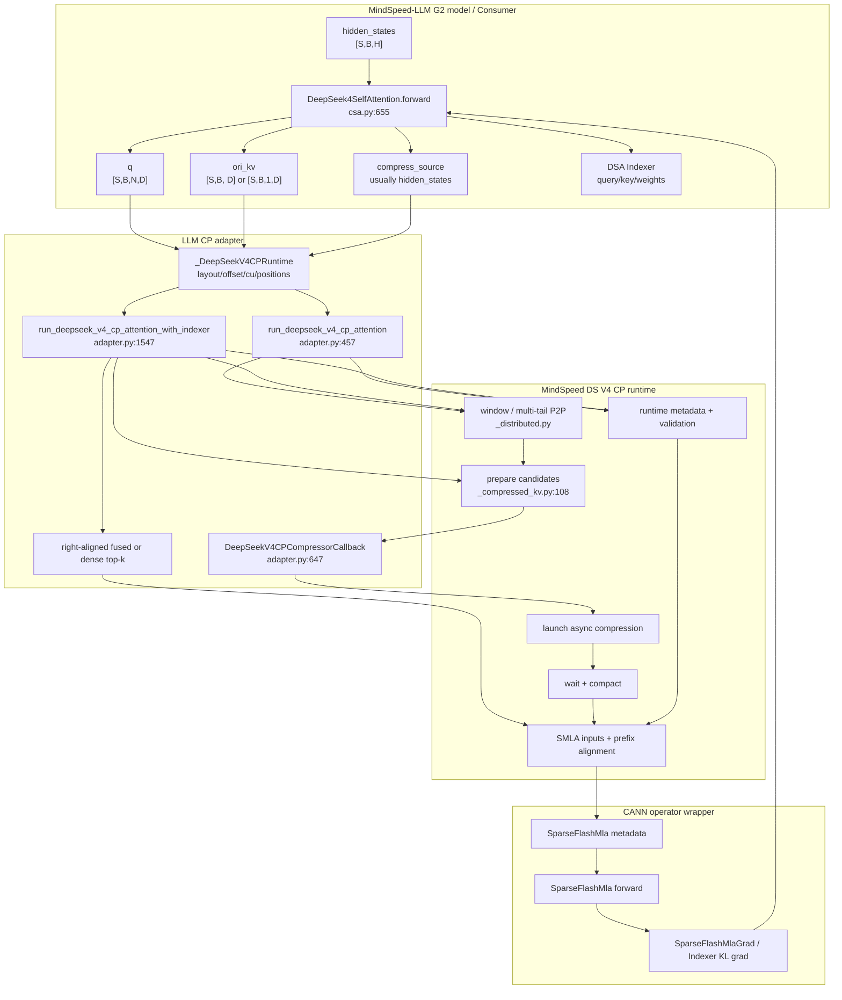

#### 2.2.1 架构分区说明

| 分区 | 关键模块 | 输入 | 输出 | 边界 |
|---|---|---|---|---|
| Consumer | `DeepSeek4SelfAttention`、`Compressor`、`DSAIndexer` | hidden states、模型配置、RoPE | q、ori_kv、compress_source、Indexer 张量 | 不负责 CP rank 通信和全局 block order |
| Adapter | `_DeepSeekV4CPRuntime`、两个 `run_*` adapter | `[S,B,...]` 模型布局 | core TND/BSND 输入、prepared KV、compact sparse indices | 不实现 CANN kernel 数学 |
| Core producer | `_distributed.py`、`_compressed_kv.py`、`_smla_inputs.py` | local source、CP group、cu/positions | compressed KV、alignment、SMLA inputs | 不持有模型 compressor 参数 |
| Operator | `npu_sparse_flash_mla.py` | SMLA inputs、metadata、sinks | NPU attention 输出和梯度 | 受 CANN layout/head/mask 硬约束 |

#### 2.2.2 图中节点逐步说明

| 节点 | 所在文件/行号 | 作用 | 关键数据语义 |
|---|---|---|---|
| `hidden_states` | `csa.py:655-691` | attention 输入和 compressor/indexer 的原料 | 不由 MindSpeed 重新投影 |
| `q` | `csa.py:690-740` | query projection、RMS、部分 RoPE 后的 query | 进入 SMLA；不参与 candidate 生产 |
| `ori_kv` | `csa.py:742-749` | shared original KV | window exchange 后供 original attention |
| `compress_source` | `csa.py:750-767` | 交给 core 切 block 的源 | 可与 `ori_kv` 不同，当前通常是 hidden states |
| `_DeepSeekV4CPRuntime` | `adapter.py:285-380` | adapter 私有不可变 runtime | 保存 layout、CP/TP/SP offset、cu 和 positions |
| `DeepSeekV4CPContextParallel` | `class.py:39-421` | 一站式 core 入口类 | 可在 `window_size` 非空时自动做窗口交换 |
| `DeepSeekV4CPCompressionCandidates` | `_types.py:95-105` | 可复用候选 state | candidate blocks、context、selection、metadata、group |
| `DeepSeekV4CPCompressedKV` | `_types.py:30-34` | 已完成 all-gather 的压缩结果 | padded compressed tensor + metadata |
| `DeepSeekV4CPSMLAInputs` | `_types.py:120-141` | operator-facing 输入束 | q、ori/cmp KV、indices、cu、residual、alignment |
| `SparseFlashMla` | `op.py:334-445` | CANN forward | 执行 C1A/C4A/C128A attention |
| `SparseFlashMlaGrad` | `op.py:448-508` | CANN backward | 返回 q/KV/sinks 及 C4A 的 `cmp_softmax_l1` |

#### 2.2.3 图中连线逐步说明

| 步骤 | 流转 | 说明 |
|---:|---|---|
| 1 | `hidden_states -> q/ori_kv` | G2 attention 完成 Q/KV 投影、norm 和 RoPE；这是模型职责。 |
| 2 | `q/ori_kv/compress_source -> adapter runtime` | adapter 根据 packed 参数选择 TND，否则选择 BSND，并计算 local/global positions。 |
| 3 | `adapter -> ContextParallel.forward` | 普通路径把 `window_size` 和 `compress_source + compress_fn` 交给类入口。 |
| 4 | `ContextParallel -> previous tails` | ratio>1 时可把 ori window tail 和 compressor tail 一次打包 P2P；ratio=1 只需 window tail。 |
| 5 | `previous tail -> candidate plan` | core 以完整 compression block 和 sample boundary 枚举本 rank 候选。 |
| 6 | `candidate plan -> compress_fn` | callback 接收 candidate-first block 和 `DeepSeekV4CPCompressContext`。 |
| 7 | `compress_fn -> async all-gather` | invalid candidate 置零、按容量补齐后发起 autograd-aware all-gather。 |
| 8 | `all-gather -> compact` | 按全局 block order 选择有效 entry，保留 `block_starts`。 |
| 9 | `compact -> SMLA inputs` | 用 AlignmentDescriptor 裁出本地 query 所需 compressed prefix。 |
| 10 | `SMLA inputs -> CANN` | wrapper 补 metadata、调用 official forward；训练时 backward 反向经过通信节点和 CANN grad。 |

#### 2.2.4 一句话串联

**G2 产生模型语义张量，adapter 统一布局和位置，core 先补跨 rank tail、再切候选/压缩/all-gather/compact，SMLA builder 将 global compressed order 对齐为 operator prefix，最后由 CANN SparseFlashMla 完成 attention。**

### 2.3 端到端顺序图

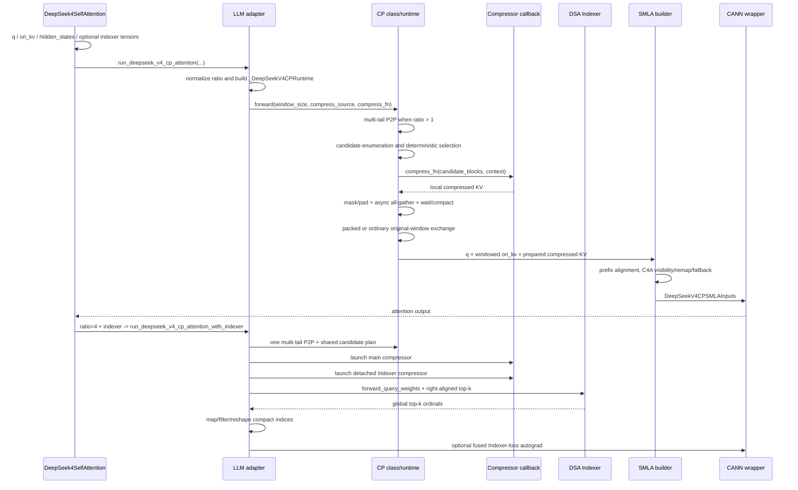

#### 2.3.1 参与方说明

| 参与方 | 文件/行号 | 职责 |
|---|---|---|
| G2 attention | `csa.py:655-1033` | 生成 q/ori_kv，按 layer mode 选择 adapter，做 output projection |
| 普通 adapter | `adapter.py:457-520` | 归一化 ratio、运行时布局转换、调用类入口、恢复输出 |
| Indexer adapter | `adapter.py:1547-1942` | 共享候选、双压缩 launch、fused/dense top-k、可选 loss |
| Core class | `class.py:84-279` | 窗口/尾部通信、候选准备、bridge 分派 |
| Core bridge | `deepseek_v4_attention.py:21-286` | validator -> prepare -> SMLA input -> op |
| CANN wrapper | `op.py:60-1544` | 官方扩展加载、metadata、forward/backward |

#### 2.3.2 时序步骤说明

1. `DeepSeek4SelfAttention.forward` 在 `csa.py:672-749` 拒绝非零 `start_pos`/inference context（DS CP），完成 q/KV 投影和 RoPE。
2. `csa.py:760-767` 在 sequence parallel 时 gather KV 与压缩源；旧 `kvallgather` 的压缩和 top-k 分支位于 `if not self.deepseek_v4_cp`（`csa.py:818-898`），DS CP 不进入该分支。
3. ratio 为 1、128，或 ratio=4 但没有 Indexer 时调用 `run_deepseek_v4_cp_attention`；ratio=4 且 `self.indexer` 非空时调用 Indexer adapter（`csa.py:909-941`）。
4. adapter 以 packed 参数是否存在选择 TND/BSND，计算 CP/TP/SP 位置和 global `cu_seqlens`。
5. 类入口压缩路径通过 `_ReceivePreviousTails` 同时拿到 ori window tail 与 compressor tail，再用同一 tail 进入候选准备和窗口构造（`class.py:163-222`）。
6. bridge 使用 `cu_seqlens_ori_kv_global` 做 block range，使用 `cu_seqlens_ori_kv` 描述实际窗口 tensor；二者不能混用。
7. SMLA builder 将 compact compressed KV 裁为最后一个 local query 所需 prefix；C4A 额外处理 indexer sparse indices。
8. op wrapper 将 BSND 的固定边界留给 operator shape inference，将 TND cu 透传给 CANN；训练 backward 重新调用官方 grad。

#### 2.3.3 两个 compressed KV 分支的区别

| 分支 | 普通 adapter | Indexer adapter |
|---|---|---|
| 候选准备 | 类入口内部 prepare | adapter 显式 prepare 一次并复用 |
| 压缩回调 | 只有 attention compressor | attention compressor + detached `indexer.kv_compressor` |
| sparse index | core visibility/index_scores 或无 | fused right-aligned top-k 或 dense top-k |
| compact 时机 | class prepare 完成后由 bridge 使用 | 分别 wait/compact Indexer key 与主 attention KV |
| 梯度 | compressed all-gather + SMLA grad | 额外可进入 Indexer KL-loss grad |

#### 2.3.4 顺序图关键结论

旧实现将“压缩 KV 准备”和“attention bridge”混在一个较宽接口中；当前实现把可复用 candidate state 暴露给 Indexer adapter，使两种 compressor 使用同一候选切分和 block order，同时通过 detached candidate state 防止 Indexer key 分支污染主 attention 输入图。

#### 2.3.5 端到端数据流与输出恢复

| 阶段 | 输入 | 处理 | 输出/不变量 |
|---|---|---|---|
| 模型前处理 | `hidden_states` | `linear_q/linear_kv`、RMS、Partial RoPE | q 与 original shared KV 的最后一维一致 |
| source 保留 | `hidden_states` 或模型私有 source | sequence-parallel 时按同一 CP shard gather | `compress_source` 不含 window，长度与 local KV shard 一致 |
| layout 归一化 | `[S,B,...]` | packed→TND，非 packed→BSND | `seq_dim` 明确为 0 或 1 |
| global metadata | CP/TP/SP rank、`cu_seqlens` | 计算 local offset、query positions、global sample boundary | 所有 rank 对同一 block 得到同一 owner |
| window path | local `ori_kv` | multi-tail 或 packed/ordinary window exchange | SMLA-facing `cu_seqlens_ori_kv` 匹配实际 tensor |
| compression path | candidate blocks | callback、mask/pad、async all-gather | `DeepSeekV4CPCompressedKV` + global `block_starts` |
| Indexer path | query/key/weights | fused/dense top-k、global→compact 映射 | C4A `cmp_sparse_indices` 为 int32、因果可见 |
| operator path | `DeepSeekV4CPSMLAInputs` | metadata inference + CANN forward | attention output 保持 core layout |
| model output | CANN output | adapter `restore_output` | 恢复为模型侧 `[S,B,N,D]`，再进入 output projection |

普通 adapter 的返回路径是 `CANN output → runtime.restore_output → csa.py 后续 output projection`；Indexer adapter 还要在返回前保证 query/key/weights 的梯度和 `loss_tracker` 生命周期不跨越已结束的 pending collective。

### 2.4 核心源码路径

当前包按“类型 → 工具/校验 → 通信 → 压缩候选 → SMLA 输入 → 入口/算子”分层。下表补回旧笔记的逐文件检索信息，并将已改名接口写成当前名称。

| 模块 | 路径 | 当前职责与关键入口 |
|---|---|---|
| 包导出 | `MindSpeed/mindspeed/core/context_parallel/deepseek_v4_context_parallel/__init__.py` | 导出 9 个 dataclass、通信 helper、prepare/launch/wait/compact、SMLA builder 和 `DeepSeekV4CPContextParallel`（`__init__.py:11-103`）。 |
| 数据类型 | `.../_types.py` | 9 个 dataclass + 1 个异步状态 Protocol；承载 metadata、pending、candidate、alignment、SMLA 输入（`_types.py:9-169`）。 |
| 工具 | `.../_utils.py` | CP size/rank、cu/shape 转换、causal visibility、score/index flatten；当前 callback 由 `_call_deepseek_v4_compress_fn` 直接调用两参数签名（`_utils.py:7-151`）。 |
| 校验 | `.../_validation.py` | layout/shape/head、cu_seqlens、query position、prepared KV 和 compress source 校验（`_validation.py:11-448`）。 |
| 分布式通信 | `.../_distributed.py` | `_ReceivePreviousTail(s)`、`_AllGatherCompressedKVAsync`、async state、多 peer balanced Indexer P2P、窗口/packed/multi-tail helper（`_distributed.py:27-617`）。 |
| 压缩 KV | `.../_compressed_kv.py` | 一步式 `prepare_deepseek_v4_compressed_kv_for_cp`，以及可复用 `prepare_*_candidates`、`launch_*`、`wait_*`、`compact_*`（`_compressed_kv.py:71-565`）。 |
| SMLA 输入 | `.../_smla_inputs.py` | runtime metadata、packed metadata、compressed cu/residual、alignment descriptor、C4A score/direct indices 和 `DeepSeekV4CPSMLAInputs`（`_smla_inputs.py:42-1222`）。 |
| Tensor bridge | `.../deepseek_v4_attention.py` | 普通 `run_deepseek_v4_cp_sparse_attention` 和 C4A Indexer-loss bridge（`deepseek_v4_attention.py:21-286`）。 |
| 入口类 | `.../deepseek_v4_context_parallel.py` | `DeepSeekV4CPContextParallel.forward` 编排 multi-tail、window、bridge 分派（`deepseek_v4_context_parallel.py:39-421`）。当前文件不再提供旧版函数式入口。 |
| CANN wrapper | `MindSpeed/mindspeed/ops/npu_sparse_flash_mla.py` | 惰性加载官方 metadata/forward/grad/KL-loss extension，校验参数并封装两个 autograd Function（1,544 行）。 |
| G2 attention | `MindSpeed-LLM/mindspeed_llm/tasks/models/transformer/deepseek4/csa.py` | `DeepSeek4SelfAttention.forward` 生成 q/ori_kv/source，并选择普通或 Indexer adapter（`csa.py:655-1033`）。 |
| LLM adapter | `MindSpeed-LLM/mindspeed_llm/tasks/models/transformer/deepseek4/deepseek_v4_cp_adapter.py` | 模型 `[S,B,...]` → TND/BSND、TP/SP/packed metadata、Compressor callback、fused/dense Indexer（1,942 行）。 |
| 模型压缩器 | `MindSpeed-LLM/.../deepseek4/compressor.py` | wkv/wgate、APE/RoPE、norm、overlap 和 candidate compression 数学（379 行）。 |
| DSA Indexer | `MindSpeed-LLM/mindspeed_llm/tasks/models/transformer/dsa_indexer.py` | query/key/weights、global top-k 与可选 Indexer-loss 输入；不是 core bridge 的必经模块。 |
| 参数/阻断 | `MindSpeed/mindspeed/arguments.py`、`.../dot_product_attention.py` | 注册 `deepseek_v4_cp_algo`，并阻断通用 DotProductAttention 误用（`arguments.py:225-237,947-955`；`dot_product_attention.py:165-200`）。 |

#### 2.4.1 包分层架构图

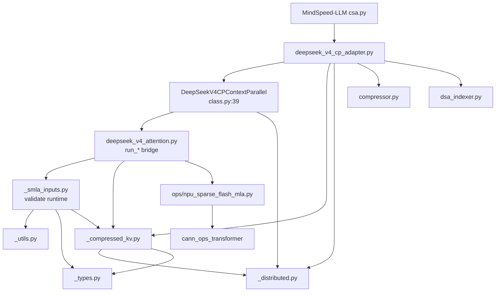

#### 2.4.2 设计与 Ulysses/Ring CP 的对标

| 方案 | 核心通信 | 输入/输出形态 | DS V4 CP 可直接复用性 |
|---|---|---|---|
| Ulysses CP | all-to-all 交换 head/sequence | attention 通用 q/k/v | 不能表达 compressed block prefix 与 C4A top-k |
| Ring Attention | 环形 P2P 轮转 KV + online softmax | 通用 causal attention | 不能直接表达 SMLA C1A/C4A/C128A 三层 KV |
| `kvallgather_cp_algo` | gather raw/compact KV | 旧 G2/Indexer 路径 | 与 DS CP 的连续 shard/position contract 不同 |
| 当前 DS V4 CP | window P2P + compressed-source tail P2P + async compressed all-gather | CANN SMLA 专用 TND/BSND | 与 DeepSeek4 compressor、shared KV 和 prefix causal 语义匹配 |

#### 2.4.3 分层边界与调用方向

```text
G2 csa.py
  └─ 只产生模型语义张量和层配置
      ↓
LLM deepseek_v4_cp_adapter.py
  └─ 负责模型布局、CP/TP/SP offset、candidate callback、Indexer
      ↓
Core deepseek_v4_context_parallel.py
  └─ 负责窗口/尾部通信与普通/Indexer bridge 分派
      ↓
Core _compressed_kv.py + _smla_inputs.py
  └─ 负责 candidate ownership、all-gather、compact、prefix/index 对齐
      ↓
ops/npu_sparse_flash_mla.py
  └─ 负责 CANN metadata、forward/backward 和 Indexer-loss extension
```

调用方向是单向的：core 不反向导入 G2 的 Compressor 或 Indexer；模型侧通过 callback 和已整理的 tensor 把数学逻辑注入 core。若在 core 中重新实现 Compressor 或在模型层直接拼 CANN 参数，会绕过这一边界并重新引入旧版的 shape/位置耦合。

### 2.5 关键指标

| 指标 | 当前值 | 依据 |
|---|---:|---|
| Core DS CP Python 文件 | 9 | `deepseek_v4_context_parallel/*.py` |
| Core DS CP 代码量 | 4,603 行 | 目录内 `wc -l` |
| CANN wrapper | 1,544 行 | `npu_sparse_flash_mla.py` |
| LLM adapter | 1,942 行 | `deepseek_v4_cp_adapter.py` |
| G2 CSA | 1,098 行 | `csa.py` |
| Compressor | 379 行 | `compressor.py` |
| Core CP 测试函数 | 112 个 `test_*` 函数，另有 NPU 测试类 | `tests_extend/.../deepseek_v4_cp` |
| LLM 集成/工具测试函数 | 96 个 `test_*` 函数 | `tests/ut/context_parallel/test_deepseek*` |
| ratio | 1/4/128 | `deepseek_v4_attention.py:99-102`、`op.py:135-196` |

### 2.6 新实现演进摘要

为避免把不同阶段的行为混在一起，按两个仓库的提交历史把主要变化列出如下：

| 阶段 | Core 提交 | LLM 提交 | 对本文的影响 |
|---|---|---|---|
| 初始能力 | `f722f9d5`（2026-06-26） | `1ba7a170`（2026-07-09） | 建立 DS V4 CP、窗口/压缩通信和模型 adapter 基础。 |
| bridge 与 NPU 校验 | `718be2c1`（2026-07-01） | `cb301843`（2026-07-14） | 形成 SMLA bridge、输入校验和集成测试边界。 |
| source/packed/runtime | `8fa6c3bd`、`ea44aca9`、`b6bd2283` | `e4cb312a`、`23fbea24` | `compress_source` 解耦、packed TND、atomic runtime 与梯度语义。 |
| 通信/显存优化 | `b4750725`、`05872d28`、`fba390a0` | `cfc36290`、`70d3a344` | compact candidate view、异步 all-gather、共享预处理和 balanced Indexer。 |
| BSND 多 batch | `5ede5cea`、`3069b02b` | `9856b5a2`、`14bbeb48` | 等长 shared-sequence BSND 支持 `B>1`，不再沿用旧的 `B=1` 结论。 |
| 当前命名整理 | `d5eb41f9`（2026-08-29） | `7028dd30`（2026-08-29） | 删除旧 config/runtime bridge，统一变量和 helper 命名；本文以此为最终基线。 |

这条演进线解释了为什么旧笔记中的某些结论会同时“曾经正确”又“对当前代码错误”：它们对应不同提交阶段。阅读本文时，应优先采用当前源码行号和第 1.1 节迁移表。

## 3. 核心模块分析

### 3.1 数据结构与运行时契约

#### 3.1.1 模块职责与边界

`_types.py` 将“候选生产阶段”“算子输入阶段”“异步等待阶段”的状态分开。当前没有旧版的 `DeepSeekV4CPRuntimeInputs` 或 `DeepSeekV4CPBridgeConfig`；模型侧直接调用 adapter 或 core bridge 的显式参数函数，adapter 内部使用 `_DeepSeekV4CPRuntime` 保存运行时状态。

#### 3.1.2 关键数据结构

| 类型 | 文件/行号 | 关键字段 | 作用 |
|---|---|---|---|
| `DeepSeekV4CPMetadata` | `_types.py:16-28` | `valid_mask`、`block_starts`、`source_rank`、`valid_count`、identity/shared flags | 描述全局 padded/compact block order |
| `DeepSeekV4CPCompressedKV` | `_types.py:30-34` | `compressed_kv`、`metadata` | 已完成 all-gather 的 KV 载体 |
| `DeepSeekV4CPPendingCompressedKV` | `_types.py:37-47` | gathered、selected、state、resolved | launch 与 wait 之间的异步句柄 |
| `DeepSeekV4CPPackedSeqMetadata` | `_types.py:49-56` | q/ori/global cu、positions、offset | packed TND shard 元数据 |
| `DeepSeekV4CPCompressContext` | `_types.py:58-93` | candidate、mask、CP、left context、positions | callback 的模型侧上下文 |
| `DeepSeekV4CPCompressionCandidates` | `_types.py:95-105` | blocks/context/selection/group/output | 主压缩与 Indexer 共享计划 |
| `DeepSeekV4CPAlignmentDescriptor` | `_types.py:107-118` | full/selected indices、global_to_local、prefix cu/residual | global compact -> operator prefix 映射 |
| `DeepSeekV4CPSMLAInputs` | `_types.py:120-141` | q、ori/cmp、indices、cu、alignment | CANN-facing 输入束 |
| `DeepSeekV4CPRuntimeMetadata` | `_types.py:144-169` | 两套 ori cu、positions、seq dims、batch | validator 与 SMLA 共用的运行时契约 |

#### 3.1.2.1 字段语义与生命周期

`DeepSeekV4CPMetadata` 是跨 rank 选择计划的不可替代部分。`valid_mask`、`block_starts` 和 `source_rank` 的第 0 维必须始终与 padded compressed KV 的候选维一致；`valid_count` 仅在有效块位于前缀时启用 identity compact 快路径。

| 字段 | 形状/类型 | 生命周期 | 关键不变量 |
|---|---|---|---|
| `valid_mask` | `[output_size]` bool | selection plan/结果中保留 padding 位置 | `False` 位置对应零填充，不参与 compact/visibility |
| `block_starts` | `[output_size]` long | 选择计划 → SMLA alignment | 有效值按全局 token 起点排序，padding 为 `-1` |
| `source_rank` | `[output_size]` long | 选择计划 → 调试/审计 | 有效值指向 CP group 内来源 rank，padding 为 `-1` |
| `local_valid_mask` | `[candidate_capacity]` bool | candidate prepare → callback | 与 callback 第 0 维一一对应 |
| `local_block_starts` | `[candidate_capacity]` long | candidate prepare → metadata | 无效候选起点为 `-1` |
| `compression_ratio` | `1/4/128` | prepare → validator | 必须与 attention 层模式一致 |
| `local_seq_len` | `int` | prepare → contract 校验 | 表示不含窗口的本地 source 长度 |
| `output_size` | `int` | all-gather → SMLA | 必须等于 compressed KV 序列维长度 |
| `valid_count` | `Optional[int]` | selection → compact | 若非空，范围为 `[0, output_size]` |
| `is_identity_compact_order` | `bool` | selection → alignment/indexer | 仅在有效块已是连续全局前缀时为真 |
| `batch_shared_sequence` | `bool` | BSND prepare → validator | BSND `B>1` 时必须为真 |

`DeepSeekV4CPPendingCompressedKV` 只存在于异步阶段；调用 `wait_deepseek_v4_compressed_kv` 后通过 `resolved` 缓存最终结果，重复 wait 不会再次等待或重排。

| 异步字段 | 作用 |
|---|---|
| `gathered_compressed` | `_AllGatherCompressedKVAsync` 返回的 rank-major 展平张量 |
| `selected_indices` | 确定性全局选择计划中的 rank-major 索引 |
| `collective_state` | 保存 async work，直到 `wait()` 显式完成 |
| `resolved` | 已 select/pad 的 `DeepSeekV4CPCompressedKV`，用于幂等 wait |

`DeepSeekV4CPAlignmentDescriptor` 解决的是“全局 compact block”与“当前 query 可见 compressed prefix”之间的坐标差异：


`DeepSeekV4CPRuntimeMetadata` 由 validator 创建一次并在 bridge 中复用。它把“实际窗口张量”和“全局压缩边界”分开，避免窗口 prepend 后重复推导位置：

| 字段 | 生产阶段 | 消费阶段 |
|---|---|---|
| `cu_seqlens_q` | q shape/layout | SMLA query、Indexer loss |
| `cu_seqlens_ori_kv` | 实际 windowed `ori_kv` shape | SMLA original KV |
| `cu_seqlens_ori_kv_global` | CP 全局 sample boundary | candidate ownership、compressed cu、visibility |
| `cu_seqlens_cmp_kv` | global boundary 与 ratio 推导 | alignment、SMLA compressed KV |
| `cmp_residual_kv` | `sample_len % ratio` | CANN compressed mask |
| `query_positions` | offset + sample boundary 推导/校验 | C4A visibility、Indexer top-k |
| `q_seq_dim`/`ori_kv_seq_dim`/`cmp_seq_dim` | layout 解析 | TND/BSND reshape 与 select |

数据状态按以下顺序单向流动：

```text
RuntimeMetadata
  -> CompressionCandidates
  -> PendingCompressedKV
  -> CompressedKV(metadata)
  -> AlignmentDescriptor
  -> SMLAInputs
  -> CANN forward/backward
```

#### 3.1.3 依赖关系


#### 3.1.4 依赖图说明

| 节点 | 文件/行号 | 依赖与输出 |
|---|---|---|
| `_DeepSeekV4CPRuntime` | `adapter.py:285-380` | 依赖 Megatron `parallel_state`；输出 core layout/metadata |
| `DeepSeekV4CPCompressContext` | `_types.py:58-93` | 由 candidate builder 创建，供模型 callback 读取 |
| `DeepSeekV4CPRuntimeMetadata` | `_types.py:144-169` | 由 runtime validator 创建，供 prepare/SMLA 复用 |
| `DeepSeekV4CPCompressionCandidates` | `_types.py:95-105` | 由 `_compressed_kv.py:108-296` 创建，Indexer 分支 detach 后复用 |
| `DeepSeekV4CPSMLAInputs` | `_types.py:120-141` | 由 `_smla_inputs.py:1040-1222` 创建，交给 op wrapper |

#### 3.1.5 运行时元数据与契约校验

`build_deepseek_v4_cp_runtime_metadata`（`_smla_inputs.py:134-295`）执行以下顺序：

1. `_validate_deepseek_v4_runtime_tensor_shapes` 检查 TND/BSND 维数、shared KV head 和 head dimension。
2. `_resolve_deepseek_v4_seq_dim` 固定 TND sequence dim=0、BSND sequence dim=1。
3. 构造/校验 `cu_seqlens_q`、实际窗口 `cu_seqlens_ori_kv` 与全局 `cu_seqlens_ori_kv_global`。
4. 生成并校验 `query_positions`，要求压缩模式下位置位于 sample boundary 且符合 CP offset。
5. ratio>1 时根据全局 boundary 计算 `cu_seqlens_cmp_kv` 与 `cmp_residual_kv`。

`validate_deepseek_v4_cp_runtime_inputs`（`_smla_inputs.py:298-362`）在此基础上检查：未传 prepared KV 时必须同时提供 `compress_source + compress_fn`；`compress_source` 的本地 sequence token 数必须等于全局序列长度除以 CP size；prepared KV 的 metadata、layout、output size、batch shared flag 必须一致。

两套 ori cu 的语义不可替代：

| 字段 | 表达的长度 | 消费者 |
|---|---|---|
| `cu_seqlens_ori_kv` | 窗口交换后的实际 `ori_kv` tensor 长度 | SMLA/CANN |
| `cu_seqlens_ori_kv_global` | 完整全局 sample 长度 | candidate block 枚举、Indexer 映射、residual |

```python
# _smla_inputs.py:225-243
    if cu_seqlens is not None:
        cu_seqlens_ori_global_tensor = _to_int32_tensor(cu_seqlens, device)
    else:
        cu_seqlens_ori_global_tensor = _default_deepseek_v4_ori_cu_seqlens(
            total_ori_seq_len, batch_size, layout_kv, device=device
        )
    _validate_deepseek_v4_cu_seqlens("cu_seqlens", cu_seqlens_ori_global_tensor)
    query_positions_tensor = _build_deepseek_v4_query_positions(
        query_positions, cu_seqlens_q_tensor,
        cu_seqlens_ori_global_tensor, local_seq_offset,
        expected_local_seq_offset, cp_size, q_token_count,
        compression_ratio, layout_q, q, device,
    )
```

### 3.2 compressed KV 准备：`prepare_deepseek_v4_compressed_kv_for_cp`

#### 3.2.1 模块职责与边界

`prepare_deepseek_v4_compressed_kv_for_cp`（`_compressed_kv.py:71-105`）是兼容的一步式入口；当前 Indexer adapter 使用更细粒度的 `prepare_deepseek_v4_compression_candidates_for_cp`（`_compressed_kv.py:108-296`）和 `launch/wait`，以便共享 candidate state。

职责顺序：

1. 将输入 source 移到 sequence-first view；BSND 的 sequence dim=1，TND=0。
2. 解析 CP size/rank、local offset、global sample boundary 和 output capacity。
3. 获取 previous tail：普通路径内部调用 `_ReceivePreviousTail`，类/Indexer 路径可传入 shared multi-tail 结果。
4. 构造候选起点、offset、valid mask、sample-local/global position。
5. 生成 padded 或 compact candidate view，并可生成 left-context reuse metadata。
6. 建立确定性 global selection plan，确保所有 rank 得到相同 block order。
7. 调用模型 `compress_fn`，mask invalid candidate，pad 到 candidate capacity。
8. 发起 async all-gather；`wait` 完成 select/pad，`compact` 移除 padding。

#### 3.2.2 内部流程图

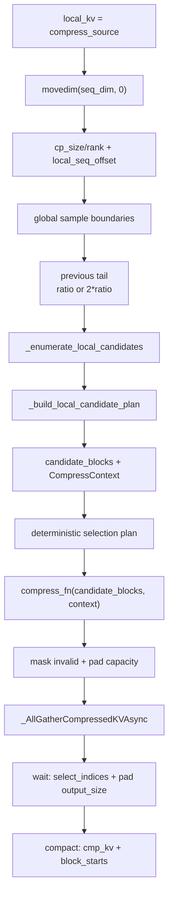

**节点说明：**

| 节点 | 文件/行号 | 说明 |
|---|---|---|
| `_enumerate_local_candidates` | `_compressed_kv.py:789-853` | 只枚举 block end 落入本 rank 连续 shard 的完整 block，避免跨 sample |
| `_build_local_candidate_plan` | `_compressed_kv.py:568-700` | 生成 padded starts/offset/position 和可选 left-context |
| `_build_left_context_reuse_metadata` | `_compressed_kv.py:703-786` | 将左邻 block 映射为本地 projection reuse 或跨 rank boundary |
| `_gather_padded_blocks` | `_compressed_kv.py:878-903` | 一次 index_select 物化 padded block 并广播 mask |
| `_build_compressed_kv_selection` | `_compressed_kv.py:914-967` | 建 metadata，关联 global selection plan |
| `_select_and_pad_gathered_compressed` | `_compressed_kv.py:1123-1142` | 从 rank-major gathered tensor 取全局顺序并补零 |

#### 3.2.3 关键代码片段

```python
# _compressed_kv.py:108-137
def prepare_deepseek_v4_compression_candidates_for_cp(
    local_kv, compression_ratio, cp_group=None,
    cp_global_ranks=None, seq_dim=0, cu_seqlens=None,
    local_seq_offset=None, output_size=None,
    include_left_context=False, previous_tail=None,
    use_compact_candidate_view=False, batch_shared_sequence=False,
):
    _validate_sequence_tensor_and_positive_length(local_kv, compression_ratio)
    normalized_seq_dim = int(seq_dim) % local_kv.dim()
    if batch_shared_sequence and normalized_seq_dim != 1:
        raise ValueError("batch-shared BSND compression requires seq_dim=1 with batch on dimension 0.")
    local_kv_seq_first = torch.movedim(local_kv, seq_dim, 0).contiguous()
    local_seq_len = local_kv_seq_first.shape[0]
    cp_size, cp_rank = _get_cp_size_and_rank(cp_group)
    if local_seq_offset is None:
        local_seq_offset = cp_rank * local_seq_len
```

```python
# _compressed_kv.py:483-518
def launch_deepseek_v4_compress_candidates_for_cp(prepared_candidates, compress_fn):
    if not isinstance(prepared_candidates, DeepSeekV4CPCompressionCandidates):
        raise TypeError("prepared_candidates must be a DeepSeekV4CPCompressionCandidates instance.")
    candidate_blocks = prepared_candidates.candidate_blocks
    compress_context = prepared_candidates.compress_context
    local_compressed = _call_deepseek_v4_compress_fn(
        compress_fn, candidate_blocks, compress_context
    )
    if not torch.is_tensor(local_compressed):
        raise TypeError("compress_fn must return a torch.Tensor.")
    local_compressed = _mask_and_pad_local_compressed(
        local_compressed, candidate_blocks, compress_context
    )
    collective_state = _AsyncCollectiveState()
    gathered_compressed = _AllGatherCompressedKVAsync.apply(
        local_compressed, prepared_candidates.cp_group, collective_state
    )
```

#### 3.2.4 candidate block 选择规则

当前算法按 block end 归属 rank，而不是按 block start 归属：

```text
global sample: [sample_start, sample_end)
block: [block_start, block_start + ratio)
rank i owns block iff:
    local_seq_offset_i < block_start + ratio <= local_seq_offset_i + local_seq_len_i
```

当 block 从前一 rank 开始、在当前 rank 结束时，当前 rank 通过 previous tail 补齐；每个 block 只由一个 rank 压缩。`candidate_capacity = local_seq_len // ratio + 1`（`_compressed_kv.py:165`）为边界候选保留容量。无效候选以 `-1` start 和 `False` mask 表示。

示例（ratio=4，rank0 持有 [0,6)，rank1 持有 [6,12)）：

```text
block [4,8) 的 start=4、end=8
rank1: 6 < 8 <= 12 -> rank1 owns it
rank1 previous tail 提供 token [4,5]
candidate_blocks 中该行最终为 [4,5,6,7]
```

#### 3.2.5 allgather 与确定性 metadata 排序

`_AllGatherCompressedKVAsync`（`_distributed.py:243-279`）将每 rank 的 `[candidate_capacity,...]` 展平为 rank-major `[cp_size*candidate_capacity,...]`。`_build_deterministic_selection_plan`（`_compressed_kv.py:1021-1084`）预先生成 `selected_indices`、`valid_mask`、`block_starts`、`source_rank`；`wait_deepseek_v4_compressed_kv`（`_compressed_kv.py:521-541`）据此 select/pad。

当前实现只对 compressed KV 数值张量执行 collective；这些 metadata 不再额外 all-gather，而是由所有 rank 根据相同的 global boundary、CP 拓扑和 ratio 本地确定性生成，再用相同的 `selected_indices` 解释 rank-major 结果。

```text
rank-major gathered index = source_rank * candidate_capacity + local_candidate_ordinal
global compact order = block_starts ascending within each sample
```

这一步保证 C4A Indexer 的 key/index score 能够与 compact block order 对齐。`valid_count` 使 identity compact order 可以用 `narrow`，非 identity 需要 `index_select`。

#### 3.2.6 选择计划、缓存与边界行为

`_build_compressed_kv_selection`（`_compressed_kv.py:914-967`）先验证 CP 分片满足“等长且按 rank 顺序连续”条件，再从全局 sample boundary 构造确定性计划。计划的核心计算为：

```text
global_block_starts = 每个 sample 内 [sample_start, sample_end) 的完整 ratio block 起点
source_rank         = floor((block_start + ratio - 1) / local_seq_len)
local_ordinal       = 该 block 在 source_rank 的候选序号
gathered_index      = source_rank * candidate_capacity + local_ordinal
```

因此每个 rank 只压缩自己拥有的 block，但所有 rank 依据相同的 `global_block_starts` 得到相同的 select 顺序。`output_size` 默认是 `total_seq_len // compression_ratio`；当 packed sample 尾部不足 ratio 时，尾部 entry 以 padding 表示，不会跨 sample 借 token。

| 情况 | 当前行为 | 依据 |
|---|---|---|
| CP=1 | 不发生真实 P2P/all-gather，仍经过相同 candidate/metadata 路径 | `_ReceivePreviousTail`、`_AllGatherCompressedKVAsync` 的 `cp_size==1` 分支 |
| CP>1 且 shard 不等长/不连续 | 在 selection 阶段抛 `ValueError` | `_uses_contiguous_rank_order_partition`（`_compressed_kv.py:970-980`） |
| sample 长度不能整除 ratio | 只保留完整 block，余数写入 `cmp_residual_kv` | `_enumerate_global_candidate_starts`（`_compressed_kv.py:1087-1109`） |
| candidate 数超过 `output_size` | 直接拒绝，防止静默截断 | `_build_deterministic_selection_plan`（`_compressed_kv.py:1034-1038`） |
| compact candidate view 可用 | 让连续、对齐的本地 source 直接 view，减少一次 materialize；否则使用 `index_select` | `_can_use_compact_candidate_view`（`_compressed_kv.py:332-387`） |
| invalid candidate | callback 后清零并保留固定容量；`compact` 时由 mask/valid_count 删除 | `_mask_and_pad_local_compressed`、`compact_deepseek_v4_compressed_kv` |

确定性选择计划按 `(sample_boundaries, cp_size, candidate_capacity, output_size, ratio, local_seq_len, device)` 作为 key，使用容量为 16 的 LRU（`_compressed_kv.py:910-1018`）。它缓存的是整数索引和 mask，不缓存模型激活；因此可降低重复 shape 的 host 计算，但不会减少 candidate compressor 或通信本身。

#### 3.2.7 异常与边界处理

| 边界/异常 | 检查位置 | 当前处理 |
|---|---|---|
| `local_kv` 非 tensor、无序列维或 ratio 非正 | `_utils.py:7-13` | 入口立即抛 `TypeError/ValueError` |
| `previous_tail` shape 与 source 不匹配 | `_distributed.py:168-184` | 按 tail 长度和 feature shape 严格拒绝 |
| cp_size>2 时 tail 长于本地 shard | `_validate_one_hop_tail_coverage`（`_distributed.py:11-24`） | 拒绝多跳隐式转发，要求调用方调整 shard/window |
| callback 返回非 tensor/候选维不一致 | `_compressed_kv.py:417-467` | 在 all-gather 前失败，不让错误进入 CANN |
| candidate 数超过固定 `output_size` | `_compressed_kv.py:1034-1038` | 拒绝静默截断 |
| 不连续或不等长 CP 分片 | `_compressed_kv.py:929-938` | 拒绝 deterministic selection，避免不同 rank 计划不一致 |
| packed sample 尾部不足 ratio | `_compressed_kv.py:1087-1109` | 丢弃不完整 block，余数由 residual 描述 |

这些检查主要保证“所有 rank 对同一 global block 得出同一 owner/ordinal”。它们不能替代模型 callback 对无效 candidate 的副作用隔离，也不能替代 CANN wrapper 的 dtype/head/top-k 校验。

### 3.3 前序窗口交换：`exchange_deepseek_v4_previous_window`

#### 3.3.1 模块职责

`exchange_deepseek_v4_previous_window`（`_distributed.py:435-486`）只负责 original KV 的局部左窗口；它不切 compressed candidate，也不参与 compressed KV all-gather。`exchange_deepseek_v4_packed_previous_window`（`_distributed.py:489-582`）是 packed TND 的 sample-aware 变体。

#### 3.3.2 关键代码

```python
# _distributed.py:435-486
def exchange_deepseek_v4_previous_window(
    local_tensor, window_size, cp_group=None,
    cp_global_ranks=None, seq_dim=0, pad_first_rank=False,
    previous_tail=None,
):
    _validate_sequence_tensor_and_positive_length(local_tensor, window_size)
    local_seq_first = torch.movedim(local_tensor, seq_dim, 0).contiguous()
    cp_size, cp_rank = _get_cp_size_and_rank(cp_group)
    prev_window = _resolve_previous_tail(local_seq_first, window_size, previous_tail, seq_dim)
    if prev_window is None:
        prev_window = _ReceivePreviousTail.apply(
            local_seq_first, window_size, cp_group,
            _resolve_global_ranks(cp_group, cp_size, cp_global_ranks),
        )
    if cp_rank == 0 and not pad_first_rank:
        return local_tensor + (prev_window.reshape(-1)[0] * 0.0)
    windowed = torch.cat((prev_window, local_seq_first), dim=0)
    return torch.movedim(windowed, 0, seq_dim).contiguous()
```

#### 3.3.3 R14 rank-0 死锁修复

rank 0 默认不 prepend window。如果直接返回 `local_tensor`，其 `_ReceivePreviousTail` 节点会被 autograd 剪枝；rank 1 backward 已发起等待 rank 0 梯度的 `irecv`，因 rank 0 不执行对应 `isend` 而死锁。当前通过 `local_tensor + prev_window.reshape(-1)[0] * 0.0` 保留零值依赖（`_distributed.py:456-484`），既不改变 forward 数值，又强制 rank 0 执行反向通信。

该修复的前提是 rank 0 仍参与同一 `ReceivePreviousTail` 图节点。直接返回输入会让节点被 PyTorch 剪枝；手工 backward hook 或强制 `pad_first_rank=True` 虽可绕开死锁，但前者增加生命周期管理，后者会改变 rank 0 的 tensor 长度。当前实现选择零值依赖，保持非 pad 模式的 shape 和 forward 数值不变。

#### 3.3.4 `_ReceivePreviousTail` 的 P2P 通信拓扑

| 阶段 | send peer | recv peer | 作用 |
|---|---|---|---|
| forward | `cp_rank+1` | `cp_rank-1` | 当前 rank 尾部给后继，接收前驱尾部 |
| backward | `cp_rank-1` | `cp_rank+1` | 将 tail gradient 回传到原始 rank |

`_send_recv`（`_distributed.py:187-195`）先提交 `irecv`、再提交 `isend`，最后统一 wait；避免环形拓扑的 launch-order cycle。`_validate_one_hop_tail_coverage`（`_distributed.py:11-24`）在 cp_size>2 时拒绝 tail 长于本地 shard，当前不做多跳转发。

#### 3.3.5 `_resolve_global_ranks` 的 local->global 映射

`_resolve_global_ranks`（`_distributed.py:303-315`）优先使用显式 `cp_global_ranks`；否则在默认 group 下使用 world rank，或调用 `dist.get_global_rank`。P2P peer 使用全局 rank，group 只限定通信域。自定义 CP group 若无法提供 global rank，必须显式传入列表。

通信 helper 的提交顺序是 `irecv -> isend -> wait`（`_send_recv`，`_distributed.py:187-207`）。先等待发送再等待接收会在环形 CP 拓扑形成 launch-order cycle；当前顺序让所有 rank 可以同时挂起收发，再统一完成。

#### 3.3.6 类入口的自动窗口交换

`DeepSeekV4CPContextParallel.forward`（`class.py:84-279`）是当前唯一将窗口交换与压缩准备编排在一起的入口。`window_size` 非空时：

1. ratio>1 且无 prepared KV：用 `_ReceivePreviousTails` 同时接收 `(ori_kv, compress_source)` 两种 tail，并把 compressor tail传给 candidate prepare。
2. packed TND：`_should_use_packed_window_exchange`（`class.py:281-318`）为真时调用 packed helper，按 sample 生成新的 `cu_seqlens_ori_kv`。
3. 普通 TND/BSND：调用 `exchange_window`（`class.py:381-416`），再由 `_sync_windowed_cu_seqlens_ori_kv`（`class.py:320-379`）使 cu 的末位匹配窗口后 tensor 长度。
4. 之后按是否提供 query/key/weights 分派普通 bridge 或 Indexer-loss bridge。

#### 3.3.7 窗口交换与压缩 KV 准备的两次 P2P

逻辑上有两种不同数据流：

| P2P | 内容 | 长度 | 触发 |
|---|---|---:|---|
| original window | `ori_kv` 前序尾部 | `window_size`，通常 128 | C1A/C4A/C128A 都需要 window 时 |
| compressed source | `compress_source` 前序尾部 | ratio 或 `2*ratio`（C4A overlap） | ratio>1 candidate prepare |

普通类入口在 ratio>1 时把两种 tail 打包为一轮 `_ReceivePreviousTails`；若走直接 tensor bridge，调用方需要自行处理 original window，而 bridge 的 compressed prepare 只处理 `compress_source`。

#### 3.3.8 packed TND 窗口的样本边界算法

`exchange_deepseek_v4_packed_previous_window`（`_distributed.py:489-582`）不能简单把一段 rank 尾部 prepend 到整个 packed tensor，否则会把某个 sample 的窗口接到另一个 sample。它按全局 `cu_seqlens` 与本 rank 的连续区间 `[local_seq_offset, local_seq_offset + local_seq_len)` 求交集：

```text
for each sample [sample_start, sample_end):
    query_slice = intersection(sample, local_rank_range)
    if query_slice is empty:
        append zero length to cu_seqlens_ori_kv
    else:
        kv_start = max(sample_start, query_start - window_size, available_prev_start)
        kv_end   = query_end
        append source[kv_start:kv_end]
```

该函数保留所有全局 sample 的零长度条目，使 `cu_seqlens_q`、`cu_seqlens_ori_kv` 和 compressed-side metadata 的 batch cardinality 一致。rank 0 在 `pad_first_rank=False` 时不会伪造前序 token；其他 rank 只使用同 sample 的前序尾部。窗口后的 `ori_kv` 可以比 query shard 更长，因此必须把新的 `cu_seqlens_ori_kv` 传给 SMLA，而不能继续使用交换前的 local boundary。

#### 3.3.9 多 tensor P2P 的数据布局

`exchange_deepseek_v4_previous_tails`（`_distributed.py:585-617`）将不同 feature 维度的 tail 展平后拼成一次 send/recv，再按原 shape 拆回：

| 发送段 | 典型长度 | 用途 |
|---|---:|---|
| `ori_kv` tail | `window_size` | original window |
| `compress_source` tail | `ratio` 或 `2*ratio` | candidate block / left-context |

该设计只要求各 tensor device/dtype 一致，允许 feature shape 不同；梯度在 `_ReceivePreviousTails.backward` 中按保存的 `tail_shapes` 和 `tail_lengths` 拆分并回传。这样类入口可以把窗口和压缩源通信合并为一轮，同时保持两条数据流的独立语义。

### 3.4 SMLA input 构造：`build_deepseek_v4_cp_smla_inputs`

#### 3.4.1 模块职责

`build_deepseek_v4_cp_smla_inputs`（`_smla_inputs.py:1040-1222`）将 q、windowed ori_kv、prepared compressed KV 和 runtime metadata 组织成 `DeepSeekV4CPSMLAInputs`。它不执行 CANN kernel，只负责：

- compact padded compressed KV；
- 建立 TND/BSND 的 prefix alignment；
- 计算 `cu_seqlens_cmp_kv` 与 residual；
- C4A direct indices/index scores 的验证、生成、remap、fallback 和 reshape；
- 复用 bridge 已构造的 `runtime_metadata`，避免重复 shape/position 推导。

#### 3.4.2 内部流程图

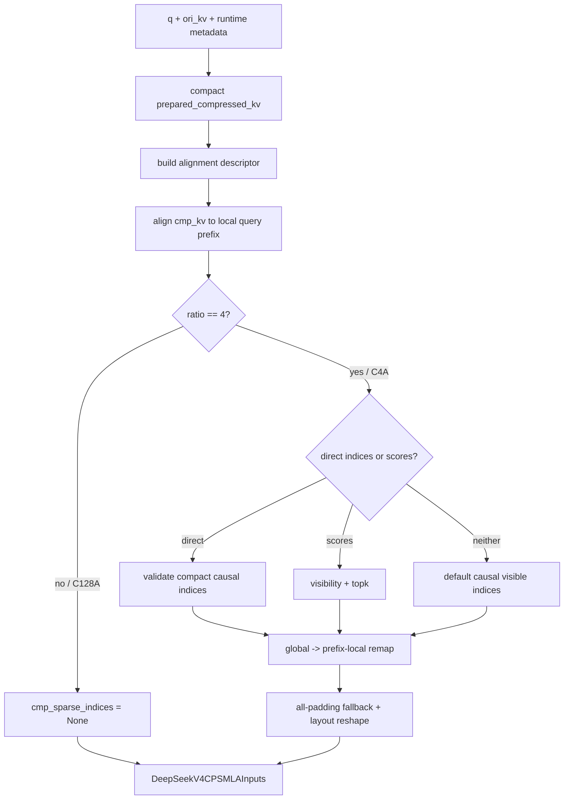

**流程步骤：**

| 步骤 | 数据流 | 关键检查/结果 |
|---:|---|---|
| 1 | q/ori_kv → runtime metadata | layout、head、batch、cu 和 query position 统一归一化 |
| 2 | prepared compressed KV → compact | 删除 invalid/padding，并取出同序 `block_starts` |
| 3 | compact blocks → alignment descriptor | 计算每个 query sample 的 compressed prefix 和 residual |
| 4 | full cmp tensor → `align_deepseek_v4_cp_tensor` | identity 用 `narrow`，非 identity 用 `index_select` |
| 5 | C4A score/direct/default → flat sparse indices | 统一成 `[query_count, topk]`，校验 int32、范围和可见性 |
| 6 | global compact index → prefix-local index | `remap_deepseek_v4_cp_sparse_indices` 使用 `global_to_local` |
| 7 | all-padding row → fallback | 仅在存在可见完整 block 时填第一个合法索引 |
| 8 | flat indices → layout reshape | BSND 恢复 `[B,S,topk]`，TND 保持 token-major |
| 9 | 全部字段 → `DeepSeekV4CPSMLAInputs` | 交给 wrapper；builder 不执行 CANN kernel |

#### 3.4.3 关键代码

```python
# _smla_inputs.py:1118-1144
    if compression_ratio > 1:
        full_cmp_kv, full_block_starts = compact_deepseek_v4_compressed_kv(
            prepared_compressed_kv,
            seq_dim=runtime_metadata.cmp_seq_dim,
        )
        alignment = _build_deepseek_v4_cp_alignment_descriptor(
            full_block_starts,
            runtime_metadata,
            compression_ratio,
            is_identity_compact_order=bool(
                prepared_compressed_kv.metadata.is_identity_compact_order
            ),
        )
        cmp_kv = align_deepseek_v4_cp_tensor(
            full_cmp_kv, alignment, runtime_metadata.cmp_seq_dim, tensor_name="cmp_kv"
        )
        block_starts = alignment.block_starts
```

#### 3.4.4 packed sequence 处理

`build_deepseek_v4_cp_packed_seq_metadata`（`_smla_inputs.py:65-131`）把 flattened local range 与 global sample boundaries 求交集，保留未落在本 rank 的零长 sample，保证 Q/Ori/Cmp 的 batch cardinality 一致。每个 sample 的 compressed 长度和 residual 为：

```text
compressed_len = floor(sample_len / compression_ratio)
residual       = sample_len % compression_ratio
```

packed TND 由 adapter 强制 physical batch size=1（`adapter.py:220-262`），但逻辑 sample 数可大于 1；跨 sample 的 block 不会被枚举或选择。

#### 3.4.5 prefix alignment 的坐标转换

SMLA 的 compressed 输入不是简单的全局 compressed KV 切片。builder 先找到每个本地 query sample 的最后位置，再只保留其之前的完整 compressed block：

```text
prefix_ori_len[s] = last_query_position[s] - global_sample_start[s] + 1
prefix_cmp_len[s] = floor(prefix_ori_len[s] / compression_ratio)
residual[s]       = prefix_ori_len[s] % compression_ratio
```

随后 `_build_deepseek_v4_cp_alignment_descriptor`（`_smla_inputs.py:715-882`）完成三步映射：

1. 在全局 compact `block_starts` 中筛出每个 sample 的 prefix block，并检查起点、顺序和数量完整。
2. 生成 `selected_global_indices` 与 `global_to_local`，把 Indexer 的全局 compact index 转成 SMLA prefix-local index。
3. 生成 prefix `cu_seqlens_cmp_kv` 与 `cmp_residual_kv`，让 CANN 的右下因果 mask 看到正确的本地 query offset。

当 metadata 表明 compact order 已经是连续 identity prefix 时，`align_deepseek_v4_cp_tensor`（`_smla_inputs.py:885-924`）使用 `narrow`；否则使用 `index_select`。两条路径的输出都必须满足 `cmp_kv` 的序列长度等于 alignment 中选出的 prefix 长度。

全 padding 的 C4A 行不能直接交给算子。`_fill_deepseek_v4_smla_cmp_sparse_fallback`（`_smla_inputs.py:961-1004`）只在该 query 存在可见完整 block 时填入样本内第一个可见 block；若样本尚无完整 block，则保留 `-1`，由上层/算子约束决定是否允许该输入。

### 3.5 C4A sparse index 构造与 `index_scores` 契约

#### 3.5.1 模块职责

core 侧提供 `build_deepseek_v4_causal_cmp_sparse_indices`（`_smla_inputs.py:388-453`）和校验函数 `validate_deepseek_v4_c4a_index_scores`/`validate_deepseek_v4_c4a_cmp_sparse_indices`（`_smla_inputs.py:456-590`）。模型侧 Indexer adapter 则在 `adapter.py:1257-1533` 先生成 global top-k，再映射到 compact prefix。

两条语义必须区分：

| 路径 | 负责者 | 输入 | 是否等价真实 DSA Indexer |
|---|---|---|---|
| core default | MindSpeed | visibility + sparse_count | 仅功能兜底，按可见 block 顺序选 |
| score-driven | 上层/第三方 | `index_scores[query, compact_block]` | 取决于模型 Indexer score 是否正确 |
| LLM fused | adapter + DSAIndexer | query/key/weights/hidden + CANN/Indexer kernel | 当前 DeepSeek4 生产路径 |

#### 3.5.2 `index_scores` shape 约束

```text
TND:  [query_count, compact_block_count]
BSND: [B, S, compact_block_count]  (内部 flatten 为 [B*S, compact_block_count])
```

第二维必须和 `compact_deepseek_v4_compressed_kv(prepared).block_starts` 顺序一致，而不是原始 global ordinal 或 rank-local 顺序。`validate_deepseek_v4_c4a_index_scores` 会构造 visibility 并要求 shape 完全一致（`_smla_inputs.py:456-487`）。

#### 3.5.3 可见性规则

`_build_deepseek_v4_cmp_visibility`（`_utils.py:63-114`）对每个 query/block 应用：

```text
1. query 与 block 位于同一 sample boundary；
2. block_start >= sample_start；
3. block_end <= sample_end；
4. block_end <= query_position + 1；
5. valid_mask=True 且 block_start>=0。
```

因此 C4A 不会跨 packed sample，也不会选择未来 block。`remap_deepseek_v4_cp_sparse_indices` 再把全局 compact index 转为每个 sample 的 SMLA prefix index；全 padding 行由 `_fill_deepseek_v4_smla_cmp_sparse_fallback` 填入第一个可见 block，避免 kernel 空行。

#### 3.5.4 Indexer 全局序号到 compact 序号

LLM Indexer 的 fused/dense 路径返回的是“全局 compressed block ordinal”，而 SMLA 需要“当前 compact 张量的列号”。`map_global_cmp_indices_to_compact`（`adapter.py:941-985`）按以下顺序转换：

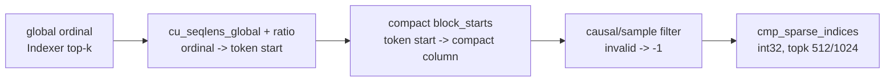

这里不能直接用 `ordinal // ratio`：packed sample 的起点可能不是 ratio 的整数倍，且 compact 过程会移除 padding entry。adapter 因此建立 token-start lookup，并在 `filter_deepseek_v4_causal_compact_indices`（`adapter.py:988-1032`）再次过滤未来块、跨样本块和越界值。只有 `identity_metadata_fast_path` 已确认全局序号与 compact 序号相同，才跳过逐元素 remap/filter；该快路径仍要求 fused Indexer 的输出已是 causal global ordinal。

### 3.6 Tensor-level bridge：`run_deepseek_v4_cp_sparse_attention`

#### 3.6.1 模块职责

普通 bridge 定义在 `deepseek_v4_attention.py:21-166`，执行：validator ->（必要时）compressed KV prepare -> SMLA inputs -> CANN wrapper。Indexer-loss bridge 定义在 `deepseek_v4_attention.py:169-286`，只接受 ratio=4，额外对齐 `key_index` 并调用 `npu_sparse_flash_mla_with_indexer_loss_from_smla_inputs`。

#### 3.6.2 当前 bridge 入口

当前 core 真实可用的是两个函数和一个类入口，不再存在旧版的 config/runtime-inputs 包装函数：

| 入口 | 文件/行号 | 自动窗口交换 | 适用场景 |
|---|---|---|---|
| `DeepSeekV4CPContextParallel.forward` | `class.py:84-279` | `window_size` 非空时自动 | G2/一站式接入，推荐 |
| `run_deepseek_v4_cp_sparse_attention` | `deepseek_v4_attention.py:21-166` | 否 | tensor-level 普通 bridge |
| `run_deepseek_v4_cp_sparse_attention_with_indexer_loss` | `deepseek_v4_attention.py:169-286` | 否 | C4A + fused Indexer-loss |

直接 bridge 的 `ori_kv` 必须已经是 windowed tensor；只有类入口负责 exchange window。ratio>1 未传 prepared KV 时，直接 bridge 要求 `compress_source` 与 `compress_fn` 同时存在。

#### 3.6.3 与入口层的关系


#### 3.6.4 runtime metadata 复用

普通 bridge 在 `deepseek_v4_attention.py:104-157` 先得到 `runtime_metadata`，再把同一对象传给 `build_deepseek_v4_cp_smla_inputs`。这样 `ori_kv_seq_dim`、`cmp_seq_dim`、global cu、query positions 不会在 prepare 和 SMLA 两处各自推导。`build_deepseek_v4_cp_smla_inputs` 文档明确警告：外部调用者不要伪造与 q/ori_kv 不同源的 runtime metadata（`_smla_inputs.py:1064-1075`）。

#### 3.6.5 关键代码

```python
# deepseek_v4_attention.py:121-133
    if compression_ratio > 1 and prepared_compressed_kv is None:
        prepared_compressed_kv = prepare_deepseek_v4_compressed_kv_for_cp(
            compress_source,
            compression_ratio,
            compress_fn,
            cp_group=cp_group,
            cp_global_ranks=cp_global_ranks,
            seq_dim=runtime_metadata.ori_kv_seq_dim,
            cu_seqlens=runtime_metadata.cu_seqlens_ori_kv_global,
            local_seq_offset=runtime_metadata.local_seq_offset,
            include_left_context=include_left_context,
            batch_shared_sequence=layout_kv == "BSND",
        )
```

#### 3.6.6 Indexer-loss bridge

`run_deepseek_v4_cp_sparse_attention_with_indexer_loss`（`deepseek_v4_attention.py:169-286`）在 SMLA inputs 形成 alignment 后，按 `key_seq_dim` 对齐 `key_index`，确保 Indexer key 与 operator-facing compressed prefix 同长同序；随后将 query/key/weights 和 loss tracker 交给 op wrapper。它不会自动生成 query/key/weights，调用方必须先准备好。

#### 3.6.7 bridge 运行时校验收益

| 输入错误 | 当前阻断位置 | 结果 |
|---|---|---|
| layout/seq_dim 混用 | `_validation.py:11-18`、`_smla_inputs.py:151-158` | 入口即报错 |
| global/window cu 混用 | `_smla_inputs.py:200-243` | 通过末位 token count 检查暴露 |
| query position 忽略 CP offset | `_validation.py:203-245` | 拒绝不连续/越界位置 |
| compressed source 长度不符 | `_validation.py:425-448` | 阻止 candidate 切分错位 |
| prepared KV metadata 不一致 | `_validation.py:375-423` | 阻止 compact/SMLA 长度失配 |
| C4A indices 越界/未来 block | `_smla_inputs.py:522-590` | 阻止非法 sparse index |

#### 3.6.8 旧 bridge 的迁移边界

旧笔记中的 bridge 设计把大量可选字段封装为 `DeepSeekV4CPBridgeConfig` 或 `DeepSeekV4CPRuntimeInputs`。在当前 core 中，这两个类型和对应 `from_config`/`from_runtime_inputs` 函数已经不再定义，也没有通过 `__init__.py` 导出。迁移时应按下表替换：

| 旧调用习惯 | 当前替换 | 需要额外处理 |
|---|---|---|
| 构造 `DeepSeekV4CPBridgeConfig` 后调用 bridge | 直接调用 `DeepSeekV4CPContextParallel.forward` | 类入口才会在传 `window_size` 时自动完成 original-window exchange。 |
| 传 `DeepSeekV4CPRuntimeInputs` | 在模型 adapter 中构造 `_DeepSeekV4CPRuntime` | adapter 同时负责 `[S,B,...]` 转换、TP/SP offset 和 packed metadata。 |
| 调用 `run_*_from_runtime_inputs` | 调 `run_deepseek_v4_cp_sparse_attention` | `ori_kv` 必须已 windowed；压缩模式显式提供 `compress_source + compress_fn` 或 prepared KV。 |
| 用单次 prepare 结果给两个 compressor | 先 `prepare_*_candidates`，再分别 `launch/wait` | Indexer 分支应使用 `_detach_deepseek_v4_cp_indexer_candidates`，避免共享主 attention 的梯度图。 |

这不是只改函数名：新入口把窗口交换、候选计划和 Indexer-loss 的生命周期拆开，调用方必须明确“谁负责窗口”“谁持有 prepared KV”“哪些张量需要梯度”。

### 3.7 SMLA 算子 wrapper：`npu_sparse_flash_mla.py`

#### 3.7.1 模块职责

`npu_sparse_flash_mla.py`（1,544 行）是官方 `cann_ops_transformer` 的薄适配层，职责包括：

1. 惰性加载 forward/grad/Indexer-loss grad extension（`op.py:60-105`）；
2. 校验 ratio/layout/head/window/mask/dtype/top-k（`op.py:108-218`）；
3. 推断或构造 metadata（`op.py:220-331`）；
4. 将 TND shared KV/index shape normalize，将 BSND cu 留给 operator shape inference（`op.py:593-689`）；
5. 通过两个 autograd.Function 保存 forward 上下文并调用官方 backward（`op.py:789-1245`）。

#### 3.7.2 算子调用链

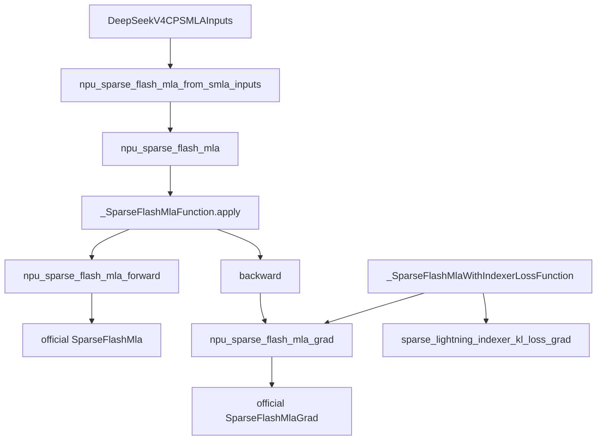

**调用链节点说明：**

| 节点 | 文件/行号 | 作用 |
|---|---|---|
| `DeepSeekV4CPSMLAInputs` | `_types.py:120-141` | 把 q、windowed ori_kv、aligned cmp_kv、indices、cu、residual 和 metadata 绑定为一个输入束 |
| `npu_sparse_flash_mla_from_smla_inputs` | `op.py:593-630` | 解包输入束，做 TND shared-KV/index normalize，再进入用户级 wrapper |
| `_SparseFlashMlaFunction` | `op.py:1056-1245` | 保存 forward 上下文并在 backward 调官方 grad |
| `_SparseFlashMlaWithIndexerLossFunction` | `op.py:789-1039` | 在标准 grad 后追加 Lightning Indexer KL-loss grad |
| `_ensure_metadata` | `op.py:1248-1322` | 缺少 CANN metadata 时按当前 shape/layout/top-k 推导并调用 metadata extension |
| `cann_ops_transformer` | `op.py:60-105` | 提供真实 metadata、forward、backward 和 KL-loss extension；不存在时延迟抛 RuntimeError |

从输入束到官方算子的顺序是“解包 → 参数校验/metadata → forward”；从 autograd 到反向的顺序是“读取 saved tensors → SparseFlashMlaGrad →（可选）Indexer KL grad”。这一区分解释了为什么 CPU mock 可以验证参数和梯度形状，却不能证明 CANN kernel 的数值与性能。

#### 3.7.3 关键约束

| 约束 | 当前值 | 代码依据 |
|---|---|---|
| `cmp_ratio` | 1/4/128 | `op.py:135-136` |
| q/kv layout | q=BSND/TND；kv=BSND/TND/PA_BBND；非 PA 必须一致 | `op.py:137-142` |
| q head dim | 512 | `op.py:156-160` |
| q heads | 1-128 且为 2 的幂 | `op.py:161-162` |
| KV heads | 1 shared KV | `op.py:164-171` |
| original mask/window | mask=4，left=127，right=0 | `op.py:145-148` |
| C1A | 不传 cmp KV/indices | `op.py:173-175` |
| C4A | cmp KV、residual、int32 indices；topk=512/1024 | `op.py:177-194` |
| C128A | 禁止 cmp_sparse_indices | `op.py:195-196` |
| TND | 必须提供 cu_seqlens | `op.py:203-209` |
| sinks | float32 | `op.py:216-217` |

#### 3.7.4 SMLA input bridge

`npu_sparse_flash_mla_from_smla_inputs`（`op.py:593-630`）将 TND `[T,D]` shared KV 变成 `[T,1,D]`，将 TND `[T,K]` sparse index 变成 `[T,1,K]`；BSND 的 fixed cu 不传给 operator。Indexer-loss 版本（`op.py:633-680`）做同样 normalize 后进入 C4A 专用入口。

#### 3.7.5 wrapper API 与反向输出

| API | 作用 | 备注 |
|---|---|---|
| `validate_sparse_flash_mla_inputs` | 在进入 extension 前校验 ratio、layout、dtype、head/window、C1A/C4A/C128A 参数组合 | `npu_sparse_flash_mla_forward` 会调用；用户级 `npu_sparse_flash_mla` 当前不会重复执行完整校验，见风险章节 |
| `infer_sparse_flash_mla_metadata_args` | 从 q/ori/cmp shape、cu 和 top-k 推导 CANN metadata 参数 | 只推导参数，不加载 extension |
| `npu_sparse_flash_mla_metadata` | 调官方 metadata extension | 需要 `cann_ops_transformer` |
| `npu_sparse_flash_mla_forward` | 调官方 SparseFlashMla，并返回 `(attn_out, softmax_lse)` | `softmax_lse` 供训练反向使用 |
| `npu_sparse_flash_mla_grad` | 调官方 SparseFlashMlaGrad | 当前反向调用时显式不传 `seqused_*` 和 metadata |
| `npu_sparse_flash_mla` | `_SparseFlashMlaFunction.apply` 的用户级入口 | 标准 attention backward |
| `npu_sparse_flash_mla_with_indexer_loss` | `_SparseFlashMlaWithIndexerLossFunction.apply` 的用户级入口 | 仅 C4A，额外返回/消费 `cmp_softmax_l1` |
| `set_sparse_flash_mla_indexer_loss_scale` | 设置 Indexer-loss 梯度缩放 | 与主训练 loss scale 对齐 |

标准反向只返回 q、ori_kv、cmp_kv、sinks 的梯度；整数索引、cu、residual 和 metadata 不可微。Indexer-loss 反向在完成标准 SMLA grad 后，再调用 `sparse_lightning_indexer_kl_loss_grad_metadata` 与 `sparse_lightning_indexer_kl_loss_grad`，将 query/key/weights 梯度按 `indexer_grad_scale * loss_coeff / num_seqs` 缩放，并通过 `loss_tracker` 记录 KL loss（`op.py:935-1039`）。

### 3.8 参数入口、导出与通用 attention 阻断

#### 3.8.1 MindSpeed/LLM 参数入口

MindSpeed core arguments 的 choices 在 `mindspeed/arguments.py:222-237` 包含 `deepseek_v4_cp_algo`；基础校验在 `mindspeed/arguments.py:947-955` 要求 causal、非 ALiBi、序列长度可被 CP size 整除，并设置 flash attention。MindSpeed-LLM 的 `ContextParallelFeature` 在 `context_parallel_feature.py:18-115` 进一步要求非 `tp_2d`、`use_sparse_flash_attn`，并检查 Indexer-loss 前置开关。

#### 3.8.2 导出接口

`__init__.py:11-103` 当前导出 33 个符号，含：

```text
DeepSeekV4CPMetadata
DeepSeekV4CPCompressedKV
DeepSeekV4CPPendingCompressedKV
DeepSeekV4CPPackedSeqMetadata
DeepSeekV4CPCompressContext
DeepSeekV4CPCompressionCandidates
DeepSeekV4CPAlignmentDescriptor
DeepSeekV4CPSMLAInputs
DeepSeekV4CPRuntimeMetadata
exchange_deepseek_v4_previous_window
exchange_deepseek_v4_packed_previous_window
exchange_deepseek_v4_previous_tails
exchange_deepseek_v4_balanced_indexer_tensors
prepare/launch/wait/compact compressed-KV helpers
runtime metadata / SMLA / C4A index helpers
DeepSeekV4CPContextParallel
```

两个 `run_deepseek_v4_cp_sparse_attention*` bridge 函数在当前 `__all__` 中未导出，第三方应从 `deepseek_v4_attention` 子模块导入，或使用类入口。

#### 3.8.3 标准 DotProductAttention 不支持 DS V4 CP

`mindspeed/core/transformer/dot_product_attention.py:160-201` 和 MindSpeed-LLM TE wrapper `te_cp_dot_product_attention.py:154-163` 都在 DS CP 下显式抛出 `NotImplementedError/AssertionError`。因此仅打开 `--context-parallel-algo deepseek_v4_cp_algo` 而继续走 generic attention 不会生效；必须使用 DeepSeek4 spec 的 G2 attention 分支。

## 4. 关键技术点深度解析

### 4.1 DeepSeek V4 论文方案实现视角

旧笔记引用的论文材料为 `/Users/liz/code/ai_infra/实现/DeepSeek_V4.pdf`，第 13、20-21、24-25 页；本节只保留与当前代码直接对应的抽象，不把论文中的模型配置误写成代码保证。

#### 4.1.1 论文中的 attention 结构

| 论文概念 | 当前 CANN/core 表达 | 模型侧实现 |
|---|---|---|
| SWA | C1A，ratio=1，only original window | `ori_kv` + window exchange |
| CSA | C4A，ratio=4，compressed KV + sparse indices | Compressor + DSAIndexer |
| HCA | C128A，ratio=128，continuous compressed KV | Compressor only |
| shared KV | `num_heads_kv=1` | G2 `linear_kv`/Compressor 输出 |
| causal prefix | AlignmentDescriptor + residual | SMLA builder/call site |
| attention sink | `sinks` float32 | `DeepSeek4SelfAttention.attn_sink`（`csa.py:252-254`） |
| Partial RoPE/APE | 不由 core 生成 | G2 与 `DeepSeekV4CPCompressorCallback` |

论文中的“query 只能看到完整 preceding compressed block”对应 `_build_deepseek_v4_cmp_visibility` 的 `block_end <= query_position+1` 条件；最近的 original window 则由 `ori_kv` 分支保留。

#### 4.1.2 论文中的 CP 两阶段通信

当前实现与论文主干的对应关系：

```text
阶段 1: raw/compressed-source tail
  rank i -> rank i+1: 尾部 ratio 个 token（C4A overlap 为 2*ratio）
  receiver: previous tail + local source
  owner: block_end 落入本 rank 的 candidate

阶段 2: compressed KV all-gather
  local candidate -> model compress_fn
  invalid candidate -> zero/pad
  async all-gather -> deterministic global selection
  compact block order -> SMLA prefix
```

与早期实现的主要差异是：当前 `_ReceivePreviousTails` 可把 ori window tail 和 compressor tail 合并成一轮 P2P；当前 all-gather 也拆成 `launch/wait`，允许 Indexer adapter 在等待主压缩时计算 query/weights。

论文规则与实现的逐项对应：

| 论文规则 | 当前代码落点 | 结果 |
|---|---|---|
| CP 沿 sequence 维连续切分 | `local_seq_offset`、`local_seq_len` 与 `_uses_contiguous_rank_order_partition` | 每个完整 block 只有一个 owner |
| 压缩 block 不能跨 packed sample | `_enumerate_local_candidates`、`_build_deepseek_v4_cmp_visibility` | sample 尾部不足 ratio 的 token 不借给下一个 sample |
| rank 交换尾部未压缩 entry | `_ReceivePreviousTail(s)` | 跨 rank block 可由后继 rank 完整压缩 |
| 本地候选固定容量 | `candidate_capacity = local_seq_len // ratio + 1` | all-gather 需要等长第一维 |
| all-gather 后全局 select/pad | `_build_deterministic_selection_plan` + `_select_and_pad_gathered_compressed` | 全局 block order 跨 rank 一致 |
| query 只能看到完整 preceding block | visibility 的 `block_end <= query_position + 1` | SMLA prefix 与 C4A indices 不产生未来块 |

论文中的“固定 `s/m + 1` 候选容量”是通信协议层面的上限，不代表每个 rank 都有这么多有效 block；有效数量由 sample boundary 和 block-end ownership 决定，其余位置必须保留 padding 以维持 all-gather shape。

#### 4.1.3 与 MindSpeed 当前实现的边界

| 能力 | MindSpeed core | MindSpeed-LLM/G2 | 当前状态 |
|---|---|---|---|
| CP group/rank 与连续 shard | 是 | 提供 topology | 已实现，强制等长连续分片 |
| raw window P2P | 是 | 传 window_size | 类入口自动，直接 bridge 手动 |
| compressed candidate 归属 | 是 | 消费 context | 已实现，按 block end 归属 |
| compressor 数学 | 否 | `Compressor` | 通过 callback 适配 |
| C4A Indexer score/top-k | 部分（visibility/default） | DSAIndexer + adapter | fused/dense 两条路径 |
| compressed prefix alignment | 是 | 使用结果 | TND/BSND 都有 descriptor |
| CANN attention | wrapper | 调用 | 依赖官方 extension |

#### 4.1.4 Flash/Pro 参数与接入配置

论文的 Flash/Pro 配置（来源：`/Users/liz/code/ai_infra/实现/DeepSeek_V4.pdf` 第 24-25 页）可作为模型侧参考，但代码真正硬约束来自 CANN：

| 配置维度 | 论文参考 | 当前代码必须满足 |
|---|---|---|
| head dimension | 512 | `op.py:156-160` 强制 512 |
| query heads | Flash 64 / Pro 128 | 需为 1-128 的 2 次幂 |
| shared KV heads | 1 | core 与 op 都校验 |
| SWA window | 128 | `ori_win_left=127/right=0` |
| CSA ratio/top-k | 4 / 512 或 1024 | C4A op 硬约束 |
| HCA ratio | 128 | 不得传 sparse indices |
| layer interleave | 模型配置决定 | G2 `args.compress_ratios[layer]` 决定 mode |

### 4.2 两阶段通信模型

#### 阶段 1：tail exchange 与 candidate

`_ReceivePreviousTail`/`_ReceivePreviousTails` 是 autograd-aware P2P；candidate builder 用 global sample boundaries 防止跨 sample block。对于 BSND，sequence dim=1 但 batch 维保留在 candidate payload；对于 TND，sample 通过 cu boundaries 逻辑打包。

阶段 1 的输入是**未经窗口 prepend 的本地 compressed source**。每个完整 block 按 `block_end` 归属唯一 rank；归属 rank 只接收恰好需要的前序 tail，不会把整个历史序列复制到每个 rank。`include_left_context=True` 时，tail 长度扩展为 `2 * compression_ratio`，供 C4A overlap compressor 使用。

#### 阶段 2：async all-gather 与 compact

`_AllGatherCompressedKVAsync.forward`（`_distributed.py:243-263`）在 cp_size>1 时以 async work 返回 flatten gathered tensor；`wait` 先等待 work，再按 `selected_indices` select/pad；反向通过 `_reduce_scatter_first_dim`（`_distributed.py:288-300`）聚合各 rank 的梯度。

all-gather 的 rank-major 排列不是最终算子顺序。`selected_indices`、`valid_mask`、`block_starts` 和 `source_rank` 由各 rank 使用同一个确定性计划生成，`wait` 阶段按全局 block 起点重排，再补到固定 `output_size`。因此“通信完成”与“可以给 Indexer 使用”之间还隔着一次 select/pad；Indexer 必须等待 compact 后的 `block_starts` 再解释 score/ordinal。

### 4.3 DS V4 CP 通信清单

| 序号 | 通信 | API/位置 | 数据 | 必经性 | backward |
|---:|---|---|---|---|---|
| 1 | original window tail | `exchange_deepseek_v4_previous_window`，`_distributed.py:435-486` | `ori_kv` tail | 类入口传 `window_size` 时 | `_ReceivePreviousTail.backward` |
| 2 | packed window | `exchange_deepseek_v4_packed_previous_window`，`_distributed.py:489-582` | `ori_kv` + sample boundary | packed TND window path | 同上 |
| 3 | multi-tail P2P | `exchange_deepseek_v4_previous_tails`，`_distributed.py:585-617` | `ori_kv` tail + source tail | ratio>1 类/Indexer path | `_ReceivePreviousTails.backward` |
| 4 | compressed KV all-gather | `_AllGatherCompressedKVAsync`，`_distributed.py:243-279` | local compressed KV | ratio>1 | reduce-scatter |
| 5 | balanced Indexer forward/restore | `exchange_deepseek_v4_balanced_indexer_tensors`，`_distributed.py:341-432` | query/weights/positions/top-k | fused identity fast path | no-grad only |

metadata（mask、starts、source rank）是确定性整数/布尔计划，不走 autograd；只有参与数值 loss 的 P2P/all-gather 才有自定义 backward。

通信顺序的实际差异如下：普通 adapter 由类入口一次完成 multi-tail、candidate、主 KV all-gather；Indexer adapter 则在同一 candidate plan 上分别发起主 attention compressor 和 detached Indexer compressor 的 all-gather，并在等待主 KV 的同时计算 query/weights/top-k。两者共享 block order，但不共享 Indexer 的梯度图。

### 4.4 `compress_fn` 的职责和契约

#### 4.4.1 合法签名

core 的 `_call_deepseek_v4_compress_fn`（`_utils.py:51-53`）当前实际直接调用两参数形式：

```python
def compress_fn(candidate_blocks, context):
    return local_compressed
```

`DeepSeekV4CPCompressorCallback`（adapter.py:647-710）实现该签名。不要把模型 `Compressor.forward(x, start_pos, freqs_cis, ...)` 直接作为 callback，因为参数粒度和 shape 不同。

#### 4.4.2 输入要求

```text
TND source:  candidate_blocks = [C, ratio, ...]
BSND source: candidate_blocks = [C, ratio, B, ...]
C = candidate_capacity = local_seq_len // ratio + 1
```

`context` 关键字段：`candidate_starts`、`valid_mask`、`local_seq_offset`、`total_seq_len`、`compression_ratio`、`cp_size/rank`、`seq_dim`、`cu_seqlens`、`candidate_positions`、`candidate_sample_positions` 以及 C4A left-context reuse metadata。

#### 4.4.3 输出要求

| 场景 | callback 输出 |
|---|---|
| TND | `[C,1,D]`（允许先 `[C,D]`，Compressor 会补 singleton head） |
| BSND shared sequence | `[C,B,1,D]`；必须保留 batch 维 |
| 所有场景 | 第 0 维必须等于 callback candidate count；core 随后按 mask 补到 capacity |

`_mask_and_pad_local_compressed`（`_compressed_kv.py:417-467`）会在 callback 返回后清零 invalid candidate。因此 callback 仍必须避免无效行更新 compressor cache、产生 NaN 或访问非法 RoPE position。

#### 4.4.4 padding candidate 与副作用

invalid candidate 的数值 mask 不能修复 callback 内的副作用。模型实现应先读取 `context.valid_mask`，对无效 block 跳过状态更新，并使用安全 position（通常 index 0）避免越界。当前 LLM callback 在预处理阶段显式 mask candidate（adapter.py:566-574），Compressor 在 postprocess 后再次 mask（compressor.py:168-187）。

### 4.5 为什么不建议把 MindSpeed 的 `compress_fn` 设计成 `hidden_states, start_pos, freqs_cis`

该签名只适合连续序列的模型内部 Compressor；DS CP 需要每个 rank 独立处理候选块和边界 metadata：

| 缺口 | 连续序列签名的问题 | context-aware callback 的解决 |
|---|---|---|
| candidate 粒度 | 无法表达 `[C,ratio,...]` | `candidate_blocks` 明确 block |
| CP 边界 | 单一 start_pos 无法表达跨 rank block | `candidate_starts`/`local_seq_offset` |
| padding | 无 valid mask | `context.valid_mask` |
| packed sample | 容易跨 sample 聚合 | `context.cu_seqlens`/sample positions |
| layout | 隐含 SBH/BSH | `seq_dim`、batch_shared flag |
| 第三方复用 | 依赖 DeepSeek4 freqs_cis | 模型自行解释 context |

因此当前 adapter 的正确方向是：core 切 block，模型 callback 在内部用自己的 `wkv/wgate/APE/norm/RoPE/rotation` 完成数学，再返回 SMLA 可接受的 compressed KV。

### 4.6 compression source 问题

`ori_kv` 与 `compress_source` 是两个独立角色：

```text
ori_kv:
  [模型投影 + norm + RoPE] -> original window attention

compress_source:
  [通常 hidden_states] -> tail exchange -> candidate blocks -> Compressor
```

普通 bridge 在 `deepseek_v4_attention.py:121-133` 将 `compress_source` 传入 prepare；不会默认把 `ori_kv` 当压缩源。G2 当前在 `csa.py:750-767` 保留 hidden states 用作 CP compressor source，再由 adapter 的 `runtime.to_bridge_layout` 转为 core layout。

| 选择 | 适用 | 代价 |
|---|---|---|
| `compress_source + compress_fn` 自动 prepare | source 与 local KV token 数一致，希望少写编排 | bridge 每次 forward 构造 candidate/all-gather |
| 显式 `prepare_*` 后传 prepared KV | 需要复用 candidate/metadata、拆分通信与计算 | 上层需保证 prepared 与 q/ori_kv 同源 |
| 完全自管 compressed KV | 已有外部 runtime/cache | 重复实现 block order 和 metadata，风险最高 |

接入时应把 source 的生命周期写清楚，避免把带窗口的 `ori_kv` 误传给 compressor：

```python
# source 只包含当前 CP rank 的本地 shard，不包含 previous-rank window。
source = hidden_states_for_cp_compress
prepared = prepare_deepseek_v4_compressed_kv_for_cp(
    local_kv=source,
    compression_ratio=4,
    compress_fn=compress_fn,
    cp_group=cp_group,
    cp_global_ranks=cp_global_ranks,
    seq_dim=0,
    cu_seqlens=global_cu_seqlens,
    local_seq_offset=local_seq_offset,
)
```

`ori_kv` 的窗口 tail 只进入 original-window 分支；compressed source 的 tail 只用于补齐 candidate block。两者即使 token 数相同，也不能仅凭 shape 互换，因为 G2 对它们施加的 norm、RoPE/APE 和 overlap 语义不同。

### 4.7 C1A、C4A、C128A 模式

| 模式 | ratio | original KV | compressed KV | sparse index |
|---|---:|---|---|---|
| C1A/SWA | 1 | windowed ori_kv | 无 | 无 |
| C4A/CSA | 4 | windowed ori_kv | compact/aligned cmp_kv | 必须 int32 top-k 512/1024 |
| C128A/HCA | 128 | windowed ori_kv | compact/aligned cmp_kv | 禁止 |

#### 4.7.1 CANN SparseFlashMla 算子硬约束

详见 `op.py:108-218`；接入方应把这些约束当作 API 前置条件，而不是 runtime 可自动转换的建议：

```text
q/ori/cmp dtype: float16 or bfloat16, same dtype
q head_dim: 512
q heads: power of two, 1..128
ori/cmp KV heads: 1
ori mask: mode 4, left 127, right 0
C1A: no cmp_kv / sparse indices
C4A: cmp_kv + residual + int32 sparse indices, topk 512/1024
C128A: cmp_kv + residual, no sparse indices
TND: cu_seqlens required
BSND: fixed boundaries inferred from shape
```

#### 4.7.2 BSND 多 batch支持的当前实现

旧版“BSND 压缩必须 batch_size=1”的结论已经失效。当前 `_resolve_batch_shared_sequence_cu_seqlens`（`_compressed_kv.py:299-329`）将每个 batch 校验为相同 global length，再折叠成共享 `(0,total_seq_len)` 计划；`DeepSeekV4CPMetadata` 仍保存一套 block order，但 compressed payload 保留 batch 维。

| 阶段 | BSND shape |
|---|---|
| adapter core q | `[B,S,N,D]` |
| ori_kv | `[B,S,1,D]` |
| candidate blocks | `[C,ratio,B,*source_non_seq_dims]`（source 是 ori_kv 时才是 `[...,1,D]`） |
| callback output | `[C,B,1,D]` |
| prepared compressed KV | `[B,C,1,D]` |
| SMLA cmp prefix | `[B,C_prefix,1,D]` |

`_get_deepseek_v4_bsnd_shared_query_metadata`（`_smla_inputs.py:593-634`）还要求所有 batch 使用同一 sample-local query position plan；变长 batch 应走 packed TND，而不是伪造 BSND shared metadata。

这里的“多 batch”是**等长、共享计划的 batch**，不是任意 ragged batch。core 仍只保存一套 1-D `block_starts`，但每个 block 的 payload 同时携带 batch 维，因此同一 block 顺序可以广播给所有 batch：

```text
global plan:   [C, ...]                 # 一套 block 起点/owner
candidate:     [C, R, B, ...]           # 每个 block 保留 B 个样本
all-gather:    [C_total, B, ...]
operator view: [B, C_prefix, 1, D]       # 通过 seq_dim=1 暴露给 SMLA
```

`_resolve_batch_shared_sequence_cu_seqlens`（`_compressed_kv.py:299-329`）把 BSND 的每个 batch boundary 校验为相同长度后折叠成共享 `(0, global_seq_len)` 计划；`_build_deepseek_v4_bsnd_cp_alignment_descriptor`（`_smla_inputs.py:637-712`）再为每个 batch 复制相同 prefix 长度和 residual。若 batch 的全局长度或 query 位置计划不同，validator 会拒绝，而不是静默复用第一 batch 的索引。

这也解释了旧版“BSND 压缩只能 B=1”结论为何失效：旧实现把 batch 维误当作额外序列分片；新实现明确把 batch 作为 payload，并将 shared plan 的限制写入 metadata/validator。需要扩展 ragged batch 时，应新增 per-batch block plan 或统一转 TND，不能简单删除当前 guard。

#### 4.7.3 两套 `cu_seqlens` 的分离设计

CP window 模式的典型单 sample（global 16，local 8，window 4）：

| rank | 实际 ori tensor | `cu_seqlens_ori_kv` | global boundary |
|---|---:|---|---|
| 0（不 pad） | 8 | `[0,8]` | `[0,16]` |
| 1 | 12 | `[0,12]` | `[0,16]` |

压缩 candidate 必须使用 global `[0,16]`，否则后半 block 不会被任何 rank 准备；SMLA operator 必须使用实际 window `[0,12]`，否则 tensor length 校验失败。

#### 4.7.4 两次 P2P 与当前重叠边界

类入口 ratio>1 将 ori/source tail 合并为一次 P2P；windowed ori 的构造仍是后续张量拼接。主 compressed KV 和 detached Indexer key 各发起一次 async all-gather。当前没有独立通信 stream 或异步 window work handle，因此 P2P 与 projection/Indexer 计算尚未完全重叠。

#### 4.7.5 `_send_recv` 的并发通信设计

`_send_recv` 的 `irecv + isend + wait` 让单轮通信的等待上界接近 `max(Trecv,Tsend)`，并在 cp_size>=3 的环形拓扑中避免先 send.wait 导致的循环等待。多 peer balanced Indexer 使用 `_batch_send_recv`（`_distributed.py:209-226`）原子提交；若 PyTorch 无 `batch_isend_irecv/P2POp` 且需要多 peer，代码主动抛错。

#### 4.7.6 `_resolve_global_ranks` 的 local->global 映射

P2P primitive 只接受 global peer id；`cp_global_ranks[local_rank]` 是唯一索引方式。custom group、非连续 world rank 或 dist-train 场景应显式传 `cp_global_ranks`，否则 fallback 的 world rank 列表可能与实际 CP group 不符。

#### 4.7.7 autograd 通信设计的判断标准

只有两类通信满足“forward 数值进入 loss 且 backward 需要跨 rank 路由”：

| Function | forward | backward |
|---|---|---|
| `_ReceivePreviousTail`/`_ReceivePreviousTails` | 获取前驱 tail | 将后继使用 tail 的梯度送回本地尾部 |
| `_AllGatherCompressedKVAsync` | all-gather local compressed KV | reduce-scatter 各 rank 使用后的梯度 |

metadata 的 mask/start/source rank 不参与可微数值计算，不需要 autograd wrapper。Indexer balanced exchange 在 `torch.no_grad()` 中只为负载均衡，不承担梯度。

### 4.8 SMLA 与 Lightning Indexer 的关系

```text
G2 DSAIndexer:
  forward_query_weights -> query_index / weights / hidden
  compressor callback    -> global key_index
  fused/dense top-k      -> global compressed-block ordinals

MindSpeed core:
  block_starts + alignment -> operator prefix
  remap/filter/fallback    -> cmp_sparse_indices
  SparseFlashMla           -> attention output
```

当前 LLM adapter 的 Indexer key 使用 `indexer.kv_compressor` 独立压缩；主 attention compressor 的 candidate 输入可共享 FP32 preprocess，但 candidate/left-context source 会在 Indexer 分支 detach。`run_deepseek_v4_right_aligned_fused_indexer`（adapter.py:1257-1416）按连续 query segment 计算 causal K prefix；BSND 版本（adapter.py:1419-1533）一次处理 batch，并复制 per-batch residual。

| Indexer 路径 | 计算方式 | CP/packed 语义 | 梯度 |
|---|---|---|---|
| fused | 按 query segment 只把因果可见的 K prefix 交给 `indexer.forward_with_scores_compress`，可在 identity compact order 下使用两段 balanced P2P | TND 按 sample/连续位置分段；BSND 复用共享 sample-local positions | 普通 top-k 在 `no_grad`；只有 fused Indexer-loss 让 query/key/weights 保留梯度 |
| dense fallback | Python/torch 分块计算 `relu(q·k)` 与权重累加，再 `topk` | `build_deepseek_v4_dense_indexer_compact_indices` 对 BSND 按 query/head chunk 处理 | top-k 本身离散；Index-loss 仍由单独 CANN KL grad 处理 |

两条路径的共同约束是 key 的第 0/1 序列维必须与 compact `block_starts` 对齐。fused 路径若启用 `identity_metadata_fast_path`，global ordinal 可以直接作为 compact index；否则必须经过 token-start lookup 和 causal filter。该区分是新 adapter 相比旧 kvallgather 路径的关键变化。

### 4.9 autograd 通信设计

标准 SMLA backward（`op.py:1056-1245`）保存 q/ori/cmp/indices/cu/residual/sinks，调用 `npu_sparse_flash_mla_grad`；它显式把 `seqused_*` 与 metadata 置为 `None`，因为当前 SparseFlashMlaGrad 不接受这些输入。Indexer-loss backward（`op.py:935-1039`）额外消费 `cmp_softmax_l1`，调用官方 KL-loss grad，并以 `indexer_grad_scale * loss_coeff / num_seqs` 缩放 query/key/weights 梯度。

| 反向阶段 | 官方输出/处理 | 传回上游 |
|---|---|---|
| 标准 SMLA | `dq`、`dori_kv`、`dcmp_kv`、`dsinks`；`softmax_lse` 仅作内部 saved tensor | q、original KV、compressed KV、sinks 的梯度；索引/metadata 为 `None` |
| Indexer-loss | 在标准 grad 中额外取 `cmp_softmax_l1`，再调用 sparse Lightning Indexer KL grad | 在 `loss_coeff` 和全局 scale 下返回 `d_query_index`、`d_key_index`、`d_weights`，并可调用 `loss_tracker` |
| P2P tail | `_ReceivePreviousTail(s).backward` 反向交换并把收到的梯度写回本地尾部 | 保证跨 rank source 的梯度与 forward owner 一致 |
| compressed all-gather | `_AllGatherCompressedKVAsync.backward` 做 reduce-scatter | 将各 rank 使用同一 compressed entry 产生的梯度聚合回 owner |

因此不能把 `cmp_sparse_indices` 当成可微 score：它是离散选择结果；需要训练 Indexer 时，必须走 query/key/weights + 官方 KL-loss 分支，而不是期待普通 SMLA backward 自动产生 Indexer 梯度。

### 4.10 性能与内存开销模型

以下是从当前实现的数据结构推导出的量级关系，不能替代目标 NPU 实测：

| 阶段 | 主要开销 | 规模关系 | 当前缓解手段 |
|---|---|---|---|
| tail P2P | 每 rank 发送/接收 `window_size` 或 `ratio` 个 token | `O(tail_len × feature_size)` | multi-tail 把两个 tail 合并一轮；`irecv/isend` 同时提交 |
| candidate materialize | 非 compact view 的 `index_select` | `O(candidate_capacity × ratio × feature_size)` | 连续对齐 source 使用 compact view |
| compressed all-gather | 每 rank 固定容量的 compressed KV | `O(cp_size × candidate_capacity × compressed_feature)` 的聚合结果 | async launch/wait，固定容量避免动态 shape |
| compact/alignment | mask/select、prefix block 映射 | `O(global_block_count + query_count)` | identity order 使用 `narrow`，选择计划 LRU 缓存 |
| dense Indexer | query-key 分块 matmul 与 top-k | `O(Q × K × H)` 计算，临时 score 按 chunk 限制 | `query_chunk_size=64`、`head_chunk_size=8`，但仍是 fallback |
| fused Indexer | CANN Indexer kernel + key prefix | 由官方 extension 决定 | right-aligned segment、identity/balanced fast path |

`launch/wait` 只把 all-gather 的等待点后移，并不减少通信字节；真正的收益来自与 query/weights/Indexer 计算重叠。若 `compact_candidate_view` 不满足对齐条件，代码会回退到 materialize，profiling 时应分别统计两条路径的命中率。

## 5. 问题与风险评估

### 5.1 高风险

| 风险 | 代码证据 | 影响 |
|---|---|---|
| Python 语法兼容 | `_distributed.py:121` 的 `return None, None, None, *grad_locals` 在当前 Python 3.7.4 实测为 `SyntaxError`；Core 声明 `>=3.8`，LLM 声明 `>=3.10` | 当前环境无法导入 core；跨支持版本缺乏编译门禁 |
| 官方 NPU 依赖 | `op.py:60-105` 动态加载 CANN；`csa.py:11-14` 无条件导入 `torch_npu` | 无匹配 TorchNPU/CANN 的环境不能执行，CPU mock 不能证明 kernel 正确 |
| 功能边界 | `csa.py:672-677` 拒绝 `start_pos!=0`/inference context；adapter.py:220-262 packed physical batch=1；core selection 要求连续等长 CP shard | 不能直接支持增量推理、KV cache、packed 多物理 batch、非均匀 CP 分片 |
| 真实 NPU correctness 未闭环 | Indexer-loss 要求 `SparseFlashMlaGrad` 返回 `cmp_softmax_l1`（`op.py:953-980`），本机缺 CANN | residual、prefix alignment、反向 shape 仍需目标芯片 golden |

### 5.2 中风险

| 风险 | 代码证据 | 影响 |
|---|---|---|
| 用户级 op 入口校验旁路 | `npu_sparse_flash_mla_forward` 校验，但 `npu_sparse_flash_mla`（`op.py:511-590`）直接 apply，autograd 内只 `_ensure_metadata` | 低层调用的非法输入可能变成 opaque CANN error |
| prepared callback 输入一致性弱 | adapter.py:683-689 使用 prepared candidate 时不再检查 data_ptr/shape/device | 手工错误配对可能静默产生错误 compressed KV |
| dense Indexer fallback O(Q*K*H) | adapter.py:1035-1154 分块 matmul/top-k | 大序列下延迟和临时 score 显存高；虽普通路径前序已 no-grad，仍有计算成本 |
| 通信阶段仍有串行点 | class.py:163-222、adapter.py:1691-1710 | P2P/窗口构造和两套 all-gather 的延迟叠加 |
| 缺 source 错误不够明确 | adapter.py:489-497 在 layout 转换前没有显式 `compress_source is None` 检查 | 可能抛 AttributeError 而不是 contract ValueError |
| 外部 metadata 语义校验不足 | `_validation.py:375-423` 未验证 starts 单调/ratio 对齐/source rank 范围 | 自管 prepared KV 可绕过部分 block-order 检查 |
| BSND 共享计划约束 | `_compressed_kv.py:299-329`、`_smla_inputs.py:593-634` 要求等长 batch、同一 query plan | 变长 batch 需要转 TND，接入成本增加 |
| callback 类型标注落后于实际调用 | `deepseek_v4_attention.py:27` 的 `Callable` 只声明一个 tensor 参数，但 `_utils.py:51-52` 实际传入 `(candidate_blocks, context)` | 静态类型检查和 IDE 提示会误导第三方实现 |

### 5.3 低风险

| 风险 | 代码证据 | 影响 |
|---|---|---|
| 空序列 helper | `build_deepseek_v4_tnd_cu_seqlens`（`_smla_inputs.py:1254-1266`）未拒绝 `seq_len=0`，会触发 arange step=0 | 错误信息不具语义 |
| bridge 可发现性 | 两个 bridge 未在 `__init__.py:59-103` 的 `__all__` 中导出 | 第三方需了解子模块路径 |
| 大量 Python segment loop | adapter.py:847-915、1353-1416 | packed sample/left-context 数量大时 host 调度成本上升 |
| 缓存可观测性 | adapter.py:85-115、core `_compressed_kv.py:910-1018` 有 bounded cache 但无命中统计 | 难以诊断多 shape 长训的 cache/显存行为 |

### 5.4 按问题类型归类

| 类型 | 当前观察 | 严重度 | 对应位置 |
|---|---|---|---|
| 代码质量 | core/adapter 文件较长，candidate、Indexer 和 layout 分支集中在少数模块，维护时需要同时理解多套 shape 语义 | 中 | `_compressed_kv.py`、`_smla_inputs.py`、`deepseek_v4_cp_adapter.py` |
| 性能 | async all-gather 已拆分，但 window/P2P、双 compressor 和 dense top-k 仍存在等待或 host loop | 中 | 4.2、5.2 |
| 架构 | CANN wrapper、core runtime 和模型 adapter 通过隐式 shape/metadata 契约连接；prepared state 的来源关系未完全编码 | 中 | `_types.py`、`_validation.py`、adapter |
| 边界/潜在 bug | Python 低版本语法、空序列 helper、packed 物理 batch>1 与 inference cache 尚未覆盖 | 高/低（按项） | 5.1、5.3 |
| 安全 | 代码未包含网络、权限或外部命令执行逻辑；当前安全边界是本地训练进程。若向不可信调用方开放 tensor API，仍需在入口限制 shape/output_size 以避免资源放大 | 低 | `validate_*` 与 `npu_sparse_flash_mla*` |

“安全风险低”不等于“无需校验”：本项目的主要风险是数值错位和运行时阻塞，而不是身份认证或数据泄露；对外复用时仍应保留 validator，不要直接暴露未校验的 CANN 参数。

## 6. 第三方模型框架接入指南

### 6.1 接入前置条件

第三方模型框架在接入前应逐项确认：

```text
1. attention forward 能生成 q、ori_kv 和独立的 compress_source。
2. 模型张量能转换为 TND 或 BSND；q/ori_kv layout 必须一致。
3. q head_dim=512，ori_kv/cmp_kv 为 shared KV（num_heads_kv=1）。
4. compression_ratio 只使用 1、4、128；LLM sentinel 0 只由 adapter 映射到 1。
5. CP shard 是连续等长分片，local_seq_offset 与 CP rank 一致。
6. C4A 能提供 compact-order Indexer indices/scores，或接受 core 默认 causal indices。
7. 压缩逻辑能适配为 compress_fn(candidate_blocks, context)。
8. packed TND 能提供一维 zero-based cu_seqlens；当前 physical batch size 必须为 1。
9. 目标环境安装兼容的 Python、Megatron、TorchNPU、CANN SparseFlashMla extension。
```

MindSpeed-LLM 自身还要求 causal mask、非 ALiBi、非 `tp_2d`、`--use-sparse-flash-attn`，并在 Indexer-loss 场景要求 DSA/fused 开关（`context_parallel_feature.py:46-115`）。

### 6.2 推荐接入路径

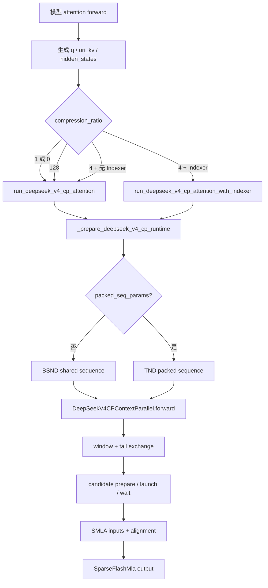

#### 6.2.1 接入路径图说明

| 节点 | 文件/行号 | 接入方动作 |
|---|---|---|
| 模型 attention forward | `csa.py:655-1033` 或等价模型入口 | 生成模型布局 q/ori_kv/source |
| 普通 adapter | `adapter.py:457-520` | 传 attention、q、ori_kv、compress_source、ratio、freqs、sinks、scale |
| Indexer adapter | `adapter.py:1547-1942` | 额外传 indexer、hidden_states、q_compressed、local freqs、args |
| `_DeepSeekV4CPRuntime` | `adapter.py:285-446` | 转换 layout、推导 cp/tp/sp offset 和 cu |
| 类入口 | `class.py:84-279` | 传 `window_size` 时自动窗口交换；可接收 prepared KV |
| core bridge | `deepseek_v4_attention.py:21-286` | validator、prepare、SMLA builder、CANN op |

#### 6.2.2 普通与 Indexer 路径的选择

```text
ratio == 1:
  只需 q + ori_kv；不传 compress_fn/source，走 C1A/SWA。

ratio == 128:
  需要 compressor；不传 sparse indices；走 C128A/HCA。

ratio == 4 且 self.indexer is None:
  普通 adapter 默认使用 core causal indices；若要注入自定义
  index_scores/cmp_sparse_indices，应直接调用 core class/bridge，因为当前
  `run_deepseek_v4_cp_attention` 本身不会生成 LLM Indexer score。

ratio == 4 且 self.indexer is not None:
  使用 Indexer adapter；它会自己构造 compact key 和 sparse indices，
  不把旧版 runtime dataclass 作为入口。
```

#### 6.2.3 G2 attention 的实际分派

G2 的分派发生在 `DeepSeek4SelfAttention.forward`（`csa.py:902-941`），而不是 generic attention 内部：

```python
# csa.py:909-941
if self.deepseek_v4_cp:
    if self.compress_ratio == 4 and self.indexer is not None:
        o = run_deepseek_v4_cp_attention_with_indexer(
            self, q, kv, hidden_states_for_cp_compress,
            self.compress_ratio, self.freqs_cis, self.attn_sink,
            self.softmax_scale, self.indexer,
            hidden_states_for_cp_indexer, q_compressed_for_cp_indexer,
            start_pos, freqs_cis_for_cp_indexer, args,
            packed_seq_params=packed_seq_params,
        )
    else:
        o = run_deepseek_v4_cp_attention(
            self, q, kv, hidden_states_for_cp_compress,
            self.compress_ratio, self.freqs_cis, self.attn_sink,
            self.softmax_scale, packed_seq_params=packed_seq_params,
        )
```

在这之前，`csa.py:690-767` 已完成 q/KV 投影、RMS、Partial RoPE，并在 sequence-parallel 模式下 gather KV 和 hidden-state source。adapter 接收到的 `compress_source` 因而是与本地 KV shard 等长的 hidden-state 张量，而不是带窗口的 `ori_kv`。

### 6.3 对外接口契约（API Reference）

当前可调用接口分为 core 类、core tensor bridge、core helper 和 LLM adapter 四组。旧版 `DeepSeekV4CPRuntimeInputs`/`DeepSeekV4CPBridgeConfig` 不属于当前接口。

#### 6.3.1 推荐入口

| 入口 | 文件/行号 | 输入形式 | 自动窗口交换 | 适用对象 |
|---|---|---|---|---|
| `DeepSeekV4CPContextParallel.forward` | `class.py:84-279` | 类状态 + 显式张量参数 | `window_size` 非空时是 | G2 或一站式模型接入，首选 |
| `run_deepseek_v4_cp_sparse_attention` | `deepseek_v4_attention.py:21-166` | 显式 tensor 参数 | 否，`ori_kv` 必须已 windowed | 底层普通 bridge/单测 |
| `run_deepseek_v4_cp_sparse_attention_with_indexer_loss` | `deepseek_v4_attention.py:169-286` | q/ori/cmp + query/key/weights | 否 | C4A fused Indexer-loss |
| `prepare_deepseek_v4_compressed_kv_for_cp` | `_compressed_kv.py:71-105` | local source + callback | 只处理 compressed source tail | 需要提前准备/缓存 compressed KV |
| `build_deepseek_v4_cp_smla_inputs` | `_smla_inputs.py:1040-1222` | prepared KV + metadata | 否 | 底层测试/自定义 adapter |

#### 6.3.2 Core class `forward` 字段契约

| 字段 | 类型/shape | 必需性 | 语义/约束 |
|---|---|---|---|
| `q` | TND `[T,N,D]` 或 BSND `[B,S,N,D]` | 必需 | q/ori layout 一致，D 与 KV 相同 |
| `ori_kv` | TND `[T,1,D]` 或 BSND `[B,S,1,D]` | 必需 | shared KV；传 `window_size` 时输入是 local-only，否则已 windowed |
| `cu_seqlens_q` | 一维 int32 | TND/packed 必需 | 末位等于本地 query token 数 |
| `cu_seqlens_ori_kv` | 一维 int32 | TND/窗口建议显式 | 描述实际 ori tensor，不是 global block boundary |
| `cp_group` | ProcessGroup/None | CP>1 必需 | 用于 P2P/all-gather |
| `cp_global_ranks` | `Sequence[int]`/None | custom group 建议 | P2P peer 的 global rank 列表 |
| `local_seq_offset` | int/None | CP/压缩建议 | 当前 local shard 的 global 起点 |
| `compress_fn` | callable/None | ratio>1 且无 prepared 时必需 | `compress_fn(candidate_blocks, context)` |
| `compress_source` | tensor/None | ratio>1 且无 prepared 时必需 | 不含 window 的 local source shard |
| `prepared_compressed_kv` | `DeepSeekV4CPCompressedKV`/None | 可替代 callback/source | sequence length 必须等于 metadata.output_size |
| `sinks` | float tensor `[N]` | 可选 | op wrapper 要求 float32 |
| `softmax_scale` | float/None | 可选 | 默认 `1/sqrt(D)`，op.py:1409-1413 |
| `query_positions` | long tensor | 压缩/BSND 强相关 | 每个 query 的 global position |
| `cu_seqlens` | global boundaries | 压缩/packed 强相关 | candidate/block/visibility 使用 |
| `include_left_context` | bool | C4A overlap 建议 True | 让 core 提供左邻 block 给模型 callback |
| `cmp_sparse_indices` | int32 | C4A 可选输入 | 与 `index_scores` 互斥；若两者都不传，builder 生成默认 causal indices，但最终 CANN 输入仍必须有 topk=512/1024 的 indices |
| `query_index/key_index/weights` | Indexer tensors | 融合 loss 条件传 | 三者应同时存在，否则不要触发 Indexer-loss bridge |

#### 6.3.3 layout、position 与 packed sequence 契约

| layout | q | ori_kv | seq_dim | 额外限制 |
|---|---|---|---:|---|
| TND | `[T,N,D]` | `[T,1,D]` | 0 | packed physical batch=1；cu 保留逻辑 sample |
| BSND | `[B,S,N,D]` | `[B,S,1,D]` | 1 | batch 等长且共享 sample-local query plan |

adapter 的模型输入仍是 `[S,B,...]`：`_model_tensor_to_deepseek_v4_cp_layout`（adapter.py:118-138）对 TND 调 `flatten_deepseek_v4_cp_tensor_to_tnd`，对 BSND 做 `transpose(0,1)`。不要把已转换的 `[B,S,...]` 再次传入该模型级 adapter。

`query_positions` 的两种表示：

```text
TND:  flatten 后每个 query token 的 global position，长度 T。
BSND: 允许传 B*S 个 global positions；adapter 会检查每个 batch 的
      sample-local plan 相同，并在 Indexer scoring 时取 shared positions。
```

#### 6.3.4 `compress_fn(candidate_blocks, context)` 回调契约

| 项 | TND | BSND shared sequence |
|---|---|---|
| candidate input | `[C,R,...]` | `[C,R,B,...]` |
| C | `local_seq_len // R + 1` | 同左，按 per-sample S 计算 |
| R | compression ratio | 1/4/128 |
| output | `[C,1,D]` 或 `[C,D]` | `[C,B,1,D]` |
| context | `DeepSeekV4CPCompressContext` | 同左，`batch_shared_sequence=True` |

callback 必须保持 candidate 第一维；core 会在 `_mask_and_pad_local_compressed`（`_compressed_kv.py:417-467`）检查并清零 invalid rows。推荐直接复用 `DeepSeekV4CPCompressorCallback`（adapter.py:647-915）。

```python
def compress_fn(candidate_blocks, context):
    valid = context.valid_mask
    # 模型侧用 candidate_starts / candidate_positions 取 RoPE 和 APE。
    projected_kv, projected_score = compressor.project_candidate_blocks(candidate_blocks)
    return compressor.compress_candidate_blocks(
        projected_kv,
        projected_score,
        freqs_for_candidates,
        candidate_blocks.dtype,
        valid_mask=valid,
        batch_shared_sequence=context.batch_shared_sequence,
    )
```

#### 6.3.5 `prepared_compressed_kv` 契约

`DeepSeekV4CPCompressedKV`（`_types.py:30-34`）必须包含：

```text
compressed_kv:
  TND  [output_size, 1, D]
  BSND [B, output_size, 1, D]

metadata:
  valid_mask/block_starts/source_rank: [output_size]
  local_valid_mask/local_block_starts: local candidate metadata
  compression_ratio/output_size/valid_count
  batch_shared_sequence=True for BSND B>1
```

`_validate_deepseek_v4_prepared_compressed_kv`（`_validation.py:375-423`）检查 type、layout、shared head、dtype/head dim、mask shape 和 output size；外部自管 prepared KV 仍应额外保证 block starts 单调且与 ratio 对齐。

#### 6.3.6 C4A `index_scores`、direct indices 与 Indexer adapter

core direct score 路径：

```text
index_scores -> _build_deepseek_v4_cmp_visibility
             -> topk / cmp_sparse_indices
             -> remap to SMLA prefix
```

LLM Indexer 路径：

```text
indexer.kv_compressor -> compact key_index
query_index/weights/hidden -> fused right-aligned or dense top-k
global ordinals -> map_global_cmp_indices_to_compact
                 -> filter_deepseek_v4_causal_compact_indices
```

| 输入 | 约束 |
|---|---|
| `index_scores` | `[query_count, compact_block_count]`；第二维严格跟随 compact `block_starts` |
| `cmp_sparse_indices` | int32；展平后 `[query_count, topk]`；topk=512/1024 |
| `query_index/key_index/weights` | Indexer-loss 三者同时提供；只允许 ratio=4 |
| `sparse_count` | core default 可用于 smoke；真实 CANN topk 仍受 512/1024 约束 |

#### 6.3.7 最小调用示例

**C1A/SWA，类入口自动窗口：**

```python
from mindspeed.core.context_parallel.deepseek_v4_context_parallel import DeepSeekV4CPContextParallel

cp = DeepSeekV4CPContextParallel(compression_ratio=1, layout_q="TND", layout_kv="TND")
out = cp.forward(
    q=q_tnd,
    ori_kv=ori_kv_tnd,
    cu_seqlens_q=cu_q,
    cu_seqlens_ori_kv=cu_ori,
    cp_group=cp_group,
    cp_global_ranks=cp_global_ranks,
    local_seq_offset=local_offset,
    sinks=sinks.float(),
    softmax_scale=512 ** -0.5,
    window_size=128,
)
```

**C128A，直接调用 tensor bridge（ori_kv 必须已 windowed）：**

```python
from mindspeed.core.context_parallel.deepseek_v4_context_parallel.deepseek_v4_attention import (
    run_deepseek_v4_cp_sparse_attention,
)

out = run_deepseek_v4_cp_sparse_attention(
    q_tnd,
    windowed_ori_kv_tnd,
    compression_ratio=128,
    compress_fn=compress_fn,
    compress_source=hidden_source_tnd,
    cu_seqlens_q=cu_q,
    cu_seqlens_ori_kv=cu_window,
    cu_seqlens=cu_global,
    query_positions=query_positions,
    cp_group=cp_group,
    cp_global_ranks=cp_global_ranks,
    local_seq_offset=local_offset,
    layout_q="TND",
    layout_kv="TND",
)
```

**C4A Indexer adapter：** 模型侧通常不直接调用该函数，而由 `DeepSeek4SelfAttention.forward`（`csa.py:909-929`）传入 `attention/indexer/hidden_states/q_compressed/freqs/args`；手动调用时必须同时满足 adapter.py:1547-1942 的参数契约。

#### 6.3.8 LLM adapter 的最小调用形态

第三方若已经有与 G2 相同的模型布局，可以复用 adapter 的编排方式；adapter 内部会生成 core 所需的 runtime，而不是要求调用方实例化已删除的 runtime dataclass：

```python
# deepseek_v4_cp_adapter.py:457-520
output = run_deepseek_v4_cp_attention(
    attention=attention,
    query=query_sbhnd,                 # [S, B, N, D]
    ori_kv=ori_kv_sbd,                 # [S, B, 1, D] or [S, B, D]
    compress_source=hidden_states,     # [S, B, H], no attention window
    compression_ratio=layer_ratio,     # 0/1/4/128; 0 -> C1A
    freqs_cis=freqs_cis,
    sinks=attention.attn_sink,
    softmax_scale=attention.softmax_scale,
    packed_seq_params=packed_seq_params,
)
```

该入口会依 `packed_seq_params` 选择 TND 或 BSND，读取 Megatron `parallel_state` 得到 CP/TP rank，计算 global/query `cu_seqlens`，再调用 `DeepSeekV4CPContextParallel.forward`。第三方若不采用 G2 adapter，至少要复现这四项语义：**模型布局转换、连续 CP offset、global sample boundary、窗口化 `ori_kv` 的实际 cu**。

### 6.4 输入数据角色与局部窗口注意力

#### 6.4.1 三类输入在 MindSpeed 中的角色

| 输入 | 生成位置 | 用途 | 不应承担的用途 |
|---|---|---|---|
| `hidden_states` | G2 attention 输入 | 作为 `compress_source`，供 Compressor/Indexer candidate | 不由 core 重新计算 q/ori_kv |
| `q` | `csa.py:690-740` | final attention query、position/shape 校验 | 不参与 compressed candidate 生产 |
| `ori_kv` | `csa.py:742-749` | original shared KV，window exchange 后进入 SMLA | 不应隐式当作 hidden-state compressor source |
| `cmp_kv` | core callback/all-gather | compressed historical KV | 不替代 original window |

#### 6.4.2 `ori_kv` 与局部窗口注意力

类入口传 `window_size` 时：

```text
rank 0:  no previous window by default, keep local ori_kv and zero dependency
rank r>0: prepend previous rank's trailing window
SMLA:    receives actual windowed cu_seqlens_ori_kv
```

packed TND 走 sample-aware `exchange_deepseek_v4_packed_previous_window`；普通 TND/BSND 走 `exchange_deepseek_v4_previous_window`，再同步 cu。直接调用 core bridge 时必须自行先做这一步。

#### 6.4.3 为什么同时传 `hidden_states`、`q` 和 `ori_kv`

```text
hidden_states/compress_source -> candidate compression
q                            -> query attention
ori_kv                       -> local original window attention
cmp_kv                       -> remote compressed history attention
```

这四者属于不同生命周期，不能用一个张量字段替代。特别是 DeepSeek4 Compressor 的 source 与 projected ori_kv 的 RoPE/APE 语义不同。

### 6.5 Step 1：启用或绕开参数入口

#### 6.5.1 参数与校验

MindSpeed core：

| 参数/校验 | 文件/行号 |
|---|---|
| `--context-parallel-algo` choice | `mindspeed/arguments.py:222-237` |
| causal、非 ALiBi、seq divisible、force flash | `mindspeed/arguments.py:947-955` |

MindSpeed-LLM：

| 参数/校验 | 文件/行号 |
|---|---|
| choice 与 DeepSeek4 allow-list | `context_parallel_feature.py:18-62` |
| DS CP causal/alibi/tp2d/seq divisibility | `context_parallel_feature.py:80-103` |
| Indexer-loss 三个前置开关 | `context_parallel_feature.py:104-115` |
| patch manager 注册 CP/RoPE/batch/attention | `context_parallel_feature.py:118-176` |

#### 6.5.2 batch slicing

`get_batch_on_this_cp_rank`（`mindspeed_llm/core/context_parallel/get_batch_utils.py:19-56`）把 DS CP 路由到 `_get_batch_on_this_cp_rank_in_ulysses_cp`（`mindspeed_llm/training/utils.py:831-842`），沿 dim=1 做连续 CP chunk。该行为必须与 core `local_seq_offset = cp_rank * local_seq_len` 一致；不能复用需要 zigzag/permutation 的旧路径。

#### 6.5.3 MTP/packed 限制

`MultiTokenPredictionFeature`（`mtp.py:75-105`）允许 DS CP reset/packed，但要求 `micro_batch_size=1` 且不允许 layerwise-disaggregated training。`core/transformer/multi_token_prediction.py:321-504` 对 `actual_seq_len`、sample-aware shift、physical batch=1、`position_ids` 和有效 loss token 做严格校验。`DeepSeek4SelfAttention.forward` 会把 canonical 一维 metadata 交给 adapter（`csa.py:672-680`）。

### 6.6 Step 2：构造 q 与 ori_kv

G2 模型侧前处理（`csa.py:690-749`）的关键顺序：

```text
hidden_states
  -> linear_q / linear_kv
  -> q_layernorm / q_up / RMS
  -> q partial RoPE
  -> kv_layernorm / kv partial RoPE
  -> q [S,B,N,D], ori_kv [S,B,1,D]
```

DS CP + sequence parallel 时，`csa.py:760-767` gather KV 和 compressor source；adapter 再依据 packed 与否转换布局。输入必须满足：

| 模型张量 | 非 packed | packed/reset |
|---|---|---|
| q | `[S,B,N,512]` | `[S,B,N,512]`，由 adapter flatten 到 TND |
| ori_kv | `[S,B,512]` 或 `[S,B,1,512]` | 同左，physical B=1 |
| compress_source | `[S,B,H]` | `[S,B,H]`，由 adapter flatten |

#### 6.6.1 TP/SP 与 CP offset 计算

adapter 的 `_build_sequence_metadata_for_deepseek_v4_cp`（`adapter.py:141-282`）把 query 与 KV 的本地长度分开计算：

```text
cp_local_kv_seq_len = KV token count / batch_size
kv_local_seq_offset = cp_rank * cp_local_kv_seq_len

若 sequence_parallel 且 KV 是完整 TP 拼接长度：
    query_tp_offset = tp_rank * query_seq_len
否则：
    query_tp_offset = 0
query_local_seq_offset = kv_local_seq_offset + query_tp_offset
```

未启用 sequence parallel 时，query 与 KV 的本地 sequence length 必须一致；启用时，KV 允许是 query 长度或 `tp_size * query` 长度，其他组合会被拒绝（`adapter.py:196-215`）。这决定了 `query_positions` 的全局起点，也决定 candidate block 的 `local_seq_offset`；不能只用 `start_pos` 或当前 tensor 的第一个下标替代。

packed/reset 场景另外要求 `packed_seq_params.cu_seqlens_q` 是一维且总长度等于完整 CP flattened KV token 数；adapter 通过 `build_deepseek_v4_cp_packed_seq_metadata` 为 query/KV 分别计算本地 sample overlap，并保留未命中 sample 的零长度条目（`adapter.py:220-262`）。

### 6.7 Step 3：实现 `compress_fn`

#### 6.7.1 直接使用当前 Compressor adapter

当前推荐直接构造：

```python
compress_fn = DeepSeekV4CPCompressorCallback(
    attention.compressor,
    freqs_cis,
    cu_seqlens=(global_cu if packed else None),
    prepared_inputs=shared_inputs,
    reuse_left_projection=(args.fp8 is None),
)
```

其内部流程（`adapter.py:664-710`）：

1. 校验 callback context ratio 与 `compressor.compress_ratio` 一致；
2. 非 FP8 时使用共享 FP32 candidate，按 `valid_mask` 预清零；
3. 调 `project_candidate_blocks` 得到 projected KV/score；
4. C4A overlap 时拼接 left context 或复用 left projection；
5. 按 `candidate_positions`（普通）或 `candidate_sample_positions`（packed）取 freqs；
6. 调 `compressor.compress_candidate_blocks` 返回 shared compressed KV。

#### 6.7.2 C4A overlap left-context

`Compressor.overlap` 仅在 ratio=4（`compressor.py:50-53`）。core candidate builder 在 `include_left_context=True` 时提供：

| context 字段 | 作用 |
|---|---|
| `left_context_blocks` | 完整左邻 raw block |
| `left_context_boundary_blocks` | compact view 下仅保留跨 rank boundary block |
| `left_context_valid_mask` | 左邻 block 是否有效 |
| `left_context_reuse_segments` | 可从当前 projected candidate 复用的连续 segment |

FP8 关闭 projection reuse；非 FP8 且 context metadata 完整时，adapter.py:832-915 直接复用 projected KV/score，降低重复投影。

#### 6.7.3 callback 的最小实现与无效行处理

第三方自定义 compressor 至少应保持 candidate-first 输出，并在模型计算前隔离无效行。下面的伪代码只展示契约，不假设具体压缩公式：

```python
def compress_fn(candidate_blocks, context):
    valid = context.valid_mask.to(device=candidate_blocks.device)
    safe_starts = context.candidate_starts.clamp_min(0)
    # 先用安全位置构造 RoPE/APE；无效行最终由 valid mask 清零。
    projected = project_model_inputs(candidate_blocks, safe_starts)
    compressed = compress_model_blocks(projected, context)
    if compressed.shape[0] != context.candidate_capacity:
        raise ValueError("callback must preserve candidate_capacity on dimension 0")
    return compressed * valid.view((-1,) + (1,) * (compressed.dim() - 1)).to(compressed.dtype)
```

`DeepSeekV4CPCompressorCallback` 还会检查 `context.compression_ratio == compressor.compress_ratio`，并在 candidate 位置超出 `freqs_cis` 范围时提前报错（`adapter.py:664-753`）。因此接入方不应仅依赖 core 的 post-mask；无效行不能更新 cache、统计量或其他有状态模块。

### 6.8 Step 4：准备 compressed KV

#### 6.8.1 自动 prepare

普通 adapter 将 source 和 callback 传给类入口；类入口 ratio>1 时会调用 `prepare_deepseek_v4_compression_candidates_for_cp`，然后 launch/wait。直接 core bridge 则在 `deepseek_v4_attention.py:121-133` 内完成一步式 prepare。

```text
compress_source -> previous source tail -> candidate blocks
                -> compress_fn -> mask/pad
                -> async all-gather -> prepared_compressed_kv
```

#### 6.8.2 显式 prepare

需要缓存或将主压缩与 Indexer 压缩分开时：

```python
candidates = prepare_deepseek_v4_compression_candidates_for_cp(
    local_kv=compress_source_tnd,
    compression_ratio=4,
    cp_group=cp_group,
    cp_global_ranks=cp_global_ranks,
    seq_dim=0,
    cu_seqlens=cu_global,
    local_seq_offset=local_offset,
    include_left_context=True,
)
pending = launch_deepseek_v4_compress_candidates_for_cp(candidates, compress_fn)
prepared = wait_deepseek_v4_compressed_kv(pending)
```

随后将 `prepared` 传给 `DeepSeekV4CPContextParallel.forward`，并把 `compress_fn/compress_source` 设为 `None`，避免重复压缩。`prepared` 仍必须与 q/ori_kv 的 layout、ratio、global boundaries 对齐。

#### 6.8.3 主压缩与 Indexer 压缩的重叠时序

Indexer adapter 使用同一 `DeepSeekV4CPCompressionCandidates` 生成两条 callback，但只让主分支保留梯度：

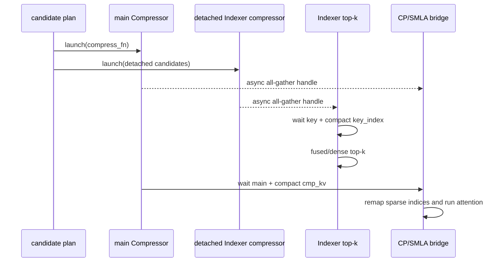

`_detach_deepseek_v4_cp_indexer_candidates`（`adapter.py:917-938`）只 detach candidate 输入和 left-context view，不会 detach compressor 参数本身；因此主 attention 与 Indexer key 可以共享 plan 和 FP32 preprocess，同时保持 Indexer-loss 的参数梯度路径可控。

### 6.9 Step 5：C4A `index_scores` 对齐

#### 6.9.1 core score-driven 路径

如果第三方框架已有 score tensor，必须先拿到 compact `block_starts`：

```text
prepared -> compact_deepseek_v4_compressed_kv
         -> block_starts (global order)
index_scores[:, j] <-> block_starts[j]
```

然后调用 `validate_deepseek_v4_c4a_index_scores`（`_smla_inputs.py:456-487`）。core 会按 visibility 屏蔽未来/跨 sample block，再生成 int32 sparse indices。

#### 6.9.2 LLM Indexer 路径

LLM adapter 的实际顺序（`adapter.py:1723-1904`）：

1. `indexer.forward_query_weights` 生成 query_index、weights、dsa_hidden_states；
2. wait detached Indexer compressed key，compact 为 key_index；
3. fused 模式调用 right-aligned Indexer；非 fused 模式调用 dense chunked top-k；
4. global top-k ordinal 通过 token-start lookup 映射到 compact index；
5. 非 identity path 过滤 causal/cross-sample index；
6. 将 sparse indices 和 prepared main KV 交给 core class。

#### 6.9.3 默认 causal indices

没有 Indexer 时可在 core bridge 传 `sparse_count=512`，由 `build_deepseek_v4_causal_cmp_sparse_indices`（`_smla_inputs.py:388-453`）按序选择可见 block。该策略只用于 smoke/功能验证，不等价于训练好的 DSA score。

### 6.10 Step 6：调用 attention bridge

#### 6.10.1 类入口（推荐）

```python
cp = DeepSeekV4CPContextParallel(
    compression_ratio=4,
    sparse_count=512,
    layout_q="BSND",
    layout_kv="BSND",
)
output = cp.forward(
    q=q_bsnd,
    ori_kv=ori_kv_bsnd,
    cu_seqlens_q=cu_q_b,
    cu_seqlens_ori_kv=cu_ori_b,
    cp_group=cp_group,
    cp_global_ranks=cp_global_ranks,
    local_seq_offset=local_offset,
    compress_fn=compress_fn,
    compress_source=source_b,
    cu_seqlens=cu_global_b,
    query_positions=positions_b,
    include_left_context=True,
    window_size=128,
)
```

#### 6.10.2 直接 core bridge

直接 bridge 不交换 original window：

```python
windowed_ori_kv = exchange_deepseek_v4_previous_window(
    local_tensor=ori_kv_tnd,
    window_size=128,
    cp_group=cp_group,
    cp_global_ranks=cp_global_ranks,
    seq_dim=0,
)
output = run_deepseek_v4_cp_sparse_attention(
    q_tnd,
    windowed_ori_kv,
    compression_ratio=4,
    compress_source=source_tnd,
    compress_fn=compress_fn,
    cu_seqlens_q=cu_q,
    cu_seqlens_ori_kv=cu_window,
    cu_seqlens=cu_global,
    query_positions=positions,
    sparse_count=512,
    cp_group=cp_group,
    cp_global_ranks=cp_global_ranks,
    local_seq_offset=local_offset,
    layout_q="TND",
    layout_kv="TND",
)
```

#### 6.10.3 融合 Indexer-loss

只在 ratio=4、训练态、grad enabled、`indexer_loss_coeff > 0`、`use_fused_lightning_indexer=True` 且 `use_fused_lightning_indexer_loss=True` 时传 query/key/weights；否则 adapter 仍可做离散 top-k，但不会进入可微 Indexer-loss bridge。adapter 会把 `loss_tracker` 与 `loss_coeff` 交给 core class，最终由 op wrapper 调官方 KL-loss grad。

### 6.11 Step 7：验证清单

| 层次 | 必测项 | 判定标准 |
|---|---|---|
| 参数 | causal、seq divisible、非 tp2d、sparse flash | validate_args 通过 |
| layout | TND/BSND q/ori/source | seq_dim、batch、head shape 正确 |
| C1A | ratio=1 + window | 无 cmp KV/indices，输出 finite |
| C128A | ratio=128 | cmp KV/residual 正确，无 sparse indices |
| C4A | ratio=4 + default/real Indexer | topk 512/1024，block order 一致 |
| candidate | CP=1/2/4、跨边界 block | `block_starts` 全局升序、无漏块/重复块 |
| packed | 多逻辑 sample、zero-length local sample | cu cardinality 一致，不跨 sample 压缩 |
| BSND | B=1 与 B>1、shared plan | `[B,C,1,D]`、per-batch residual 正确 |
| TP/SP | tp=1/2、sequence_parallel on/off | query offset 与 KV offset 一致 |
| backward | tail P2P、all-gather、SMLA grad | 梯度 shape/finite，rank0 不死锁 |
| MTP | actual_seq_len、shift、loss mask | sample-aware shift 保持边界 |
| hardware | CANN 版本、910B/目标芯片 | official forward/backward golden |
| performance | HBM、step time、通信占比 | 与 kvallgather baseline 对比 |

## 7. MindSpeed-LLM 当前接入状态

### 7.1 已具备的能力

| 能力 | 当前文件/行号 | 状态 |
|---|---|---|
| DS CP CLI choice 与校验 | `context_parallel_feature.py:18-115` | 已支持 `deepseek_v4_cp_algo`、causal、seq divisibility、Indexer prerequisites |
| CP/RoPE/batch/attention patch | `context_parallel_feature.py:118-176` | 已注册；DS CP 不走 generic DotProductAttention |
| G2 DeepSeek4 layer spec | `deepseek4_spec.py:33-90` | `DeepSeek4SelfAttention`/MTP attention + Compressor/DSA submodules |
| q/KV pre-attention | `csa.py:690-749` | projection、RMS、Partial RoPE、shared KV |
| DS CP 分支 | `csa.py:760-767,909-941` | sequence-parallel gather 后调用两个 adapter |
| TND packed metadata/position | `deepseek_utils.py:13-178` | 一维 cu、sample-local RoPE position |
| model Compressor | `compressor.py:33-379` | wkv/wgate/APE/norm/overlap/rotation，支持 candidate callback |
| C4A DSA Indexer | `dsa_indexer.py:235-672` | query/weights/key compressor/fused score |
| BSND 多 batch | `adapter.py:1157-1254`、core BSND descriptor | shared sequence、向量化 batch top-k |
| fused/dense C4A adapter | `adapter.py:1035-1533` | global ordinal 映射和 causal filter |
| fused Indexer-loss | `adapter.py:1536-1942`、op.py:789-1040 | 可选 query/key/weights 梯度与 KL tracker |

### 7.2 当前仍存在的限制

| 限制 | 代码证据 | 接入影响 |
|---|---|---|
| 训练起点固定 | `csa.py:672-675` | `start_pos != 0` 直接拒绝 |
| 无 inference KV cache | `csa.py:675-677` | 不能直接用于增量解码 |
| packed physical batch=1 | `adapter.py:220-262`、`mtp.py:93-100` | packed 多物理 batch 需改 metadata 设计 |
| BSND 等长/shared position | `_compressed_kv.py:299-329`、`_smla_inputs.py:593-634` | 变长 batch 应改走 TND |
| CANN hard contract | `op.py:135-218` | 非 512 head dim、非 shared KV、其他 topk/layout 不支持 |
| bridge 非 root export | `__init__.py:59-103` | 第三方需从 `deepseek_v4_attention` 子模块导入 |
| Python 版本门槛 | Core `setup.py:76`、LLM `setup.py:106` | 运行环境不能使用当前 Python 3.7 |

### 7.3 为什么 LLM Compressor 需要 adapter

`Compressor.forward`（`compressor.py:306-379`，实际签名含可选 `packed_seq_params`）面向模型布局的连续序列：

```text
x [S,B,H] + start_pos + freqs_cis (+ packed_seq_params) -> kv_compress [S/R,B,D]
```

非 packed 的 `Compressor.forward` 返回模型侧 `[S/R,B,D]`；TND packed 分支按 sample 处理后同样返回 compressed rows。`DeepSeekV4CPCompressorCallback` 再把 candidate-first 结果规范成 core/CANN 需要的 `[C,1,D]` 或 `[C,B,1,D]`，因此不能把 `Compressor.forward` 本身直接当作 core callback。

core callback 面向 CP candidate：

```text
candidate_blocks [C,R,B,...] + context -> candidate-first compressed KV
```

差异在于：

| 维度 | 连续 Compressor | CP callback |
|---|---|---|
| 粒度 | 整段序列 | rank-owned block |
| 位置 | 单一 start_pos | 每行 candidate_starts/sample positions |
| padding | 没有 candidate padding | valid_mask 必须处理 |
| CP 边界 | 由上层 gather | previous tail + block_end ownership |
| packed | packed_seq_params 直接循环 | context.cu_seqlens + sample-safe blocks |
| BSND | 输出按 batch 常规布局 | 必须保持 `[C,B,1,D]` candidate-first |

因此当前 `DeepSeekV4CPCompressorCallback` 不是多余包装，而是模型数学和 core CP contract 的边界层。

### 7.4 新旧接入状态对照

下表保留旧笔记的“当前缺口”视角，但把结论更新到 `ds-0829`：

| 旧版结论 | 新实现状态 | 仍需注意 |
|---|---|---|
| LLM 只能走 `kvallgather_cp_algo` | `ContextParallelFeature` 已允许 `deepseek_v4_cp_algo`，G2 在 `csa.py:909-941` 有专用分派 | generic DotProductAttention 仍被明确阻断，必须使用 DeepSeek4 spec。 |
| core 只有一次性压缩 bridge | core 暴露 candidate prepare、async launch/wait 和 compact | 一步式 `prepare_deepseek_v4_compressed_kv_for_cp` 仍保留，适合简单调用。 |
| compressor 只能整段调用 | `DeepSeekV4CPCompressorCallback` 支持 candidate-first block、位置和 left-context | callback 必须保留 candidate 维，并处理 invalid rows。 |
| BSND 压缩只能 `B=1` | 等长 shared-sequence BSND 支持 `B>1`，payload 保留 batch 维 | 变长 batch 仍应走 packed TND；MTP packed 仍要求物理 batch=1。 |
| C4A index 直接使用 rank-local ordinal | adapter 先通过 `block_starts` 映射 global ordinal，再做 causal filter | score/indices 必须与 compact order 对齐。 |
| P2P 只处理单个 tensor | `_ReceivePreviousTails` 可一次交换 ori/source 多 tensor | 各 tensor device/dtype 必须一致；多跳 tail 仍不支持。 |

因此旧笔记中“尚未接入”类描述不再整体适用：当前主要缺口已经从“没有调用链”转为 **目标 CANN 上的真实性能/反向验证、packed 物理 batch 扩展和 inference cache**。

## 8. 技术选型对比

### 8.1 compressed KV 准备方式对比

| 方案 | 正确性 | 性能 | 复杂度 | 维护性 | 适用结论 |
|---|---:|---:|---:|---:|---|
| bridge/类入口自动 `compress_source + compress_fn` | 5/5 | 4/5 | 4/5 | 5/5 | 当前默认；少量调用代码，复用 core candidate/通信 |
| 上层显式 prepare + `prepared_compressed_kv` | 5/5 | 5/5 | 3/5 | 4/5 | 适合缓存、双 compressor、提前做 metadata |
| 上层完全自管 compressed KV/metadata | 3/5 | 4/5 | 2/5 | 2/5 | 只有已有成熟 runtime 时采用 |
| 复用旧 `kvallgather_cp_algo` | 2/5 | 3/5 | 4/5 | 4/5 | 不能替代 SMLA prefix/C4A semantics；generic DS path 明确阻断 |

### 8.2 `compress_fn` 入参设计对比

| 方案 | CP 语义 | LLM 复用 | 第三方适配 | 结论 |
|---|---:|---:|---:|---|
| `compress_fn(candidate_blocks)` | 1/5 | 2/5 | 2/5 | 仅存在于更早的设计文档；当前 `_call_deepseek_v4_compress_fn` 不再做一参数自适应，直接传两个参数，旧 callback 会在运行时失败 |
| `compress_fn(candidate_blocks, context)` | 5/5 | 5/5 | 5/5 | 当前标准；模型拥有数学，core 拥有 CP |
| `compress_fn(hidden_states, start_pos, freqs_cis)` | 2/5 | 5/5 | 2/5 | 只适合模型内部连续 Compressor |
| callback + 显式 model context 对象 | 5/5 | 4/5 | 4/5 | 后续可扩展，但需控制生命周期和缓存 |

## 9. 优化建议

### 9.1 MindSpeed Core 侧建议

| 建议 | 对应风险/收益 | 优先级 | 难度 |
|---|---|---|---|
| 修复 `_distributed.py:121` starred return，加入 3.8/3.10/3.12 compile CI | 解除导入阻断 | P0 | 低 |
| 在 `npu_sparse_flash_mla` 用户入口保留轻量 validator | 避免低层 opaque CANN error | P1 | 中 |
| 校验 prepared `block_starts/source_rank` 单调、范围、ratio 对齐 | 防止自管 metadata 静默错配 | P1 | 中 |
| 给 candidate/prepared state 增加 plan id 或 data_ptr 检查 | 恢复 adapter refactor 后的契约保护 | P1 | 中 |
| 增加 `seq_len==0` guard 和稳定 root exports | 改善边界/API 可用性 | P1 | 低 |
| 设计异步 P2P work handle，和 candidate projection/window metadata 重叠 | 降低通信串行占比 | P2 | 高 |
| 记录 deterministic cache、candidate count、all-gather wait 时间 | 让长训性能可观测 | P1 | 中 |
| 将 bridge 的 `compress_fn` 类型标注改为二参数 Protocol，并增加 callback contract test | 让签名与运行时一致，尽早发现第三方适配错误 | P1 | 低 |

### 9.2 MindSpeed-LLM 侧建议

| 建议 | 对应问题/收益 | 优先级 | 难度 |
|---|---|---|---|
| 将 `compress_source is None` 在 adapter 入口显式报错 | 提升接入错误可读性 | P0 | 低 |
| 将 dense Indexer top-k 改为流式 key 归约或统一 fused kernel | 降低 O(Q*K*H) 临时开销 | P1 | 中 |
| 把 packed B>1 作为独立 metadata 设计，不放宽 shared plan guard | 保持正确性并支持变长 | P2 | 高 |
| 将 C4A main/indexer candidate plan 与 prepared state 绑定 | 防止双 compressor source 漂移 | P1 | 中 |
| 为 TP>1 + SP + packed 建立端到端 NPU golden | 覆盖最容易错位的 query/KV offset | P0 | 高 |
| 明确 `DeepSeek4MTPSelfAttention` 的 DS CP ratio=1 语义 | 避免 MTP 层误启用 compressor/indexer | P1 | 低 |

### 9.3 第三方框架接入建议

| 建议 | 说明 |
|---|---|
| 先跑 C1A，再跑 C128A，最后接 C4A | 逐步隔离 window、compression、top-k 风险 |
| 始终显式传 `compress_source` | 不依赖 `ori_kv` 隐式推断，保持 source 语义清晰 |
| 优先使用类入口并传 `window_size` | 避免忘记 original window exchange/cu sync |
| 用 `prepared_compressed_kv.metadata.block_starts` 做断言 | 验证 compact order 后再接真实 Indexer |
| CP=1 与 CP>1 做数值/梯度等价 | CP=1 作为无通信 reference |
| 将 CANN/TorchNPU 版本写入实验元数据 | `cmp_mask_mode`、empty batch、grad 输出可能随版本变化 |

### 9.4 风险—措施对应关系

| 风险 | 对应措施 | 验收信号 |
|---|---|---|
| Python 语法/导入阻断 | 修复 starred return 并对声明版本执行 `compileall`/import CI | 3.8、3.10、3.12 均可导入 core |
| CANN 真实 forward/backward 未闭环 | 建立 C1A/C4A/C128A、TND/BSND、CP=1/2/4 golden | 输出/梯度与 CP=1 reference 在容差内一致 |
| prepared metadata 可被错误配对 | 为 candidate/prepared state 增加 plan identity、starts 单调和 source rank 校验 | 错配在 bridge 前失败且错误指向字段 |
| dense Indexer 与通信等待 | 使用流式/fused top-k，重叠 P2P/all-gather 与 projection | HBM 峰值和通信 wait 占比下降，数值不变 |
| packed B>1 / inference cache 缺口 | 单独设计 per-sample metadata/cache 生命周期，不放宽当前 guard | 新路径有独立 contract 和回归矩阵 |
| API 可发现性不足 | 在 root `__init__` 增加稳定 bridge export 或提供正式迁移文档 | 第三方无需依赖私有子模块猜路径 |

## 10. 成本估算与演进路线

### 10.1 开发周期估算

| 阶段 | 工作内容 | 人力/周期估算 | 主要成本 |
|---|---|---:|---|
| 0 | 语法、入口校验、支持版本 CI | 1 人 1-2 日 | Python/Megatron 构建环境 |
| 1 | C1A/C128A core + G2 主链路 NPU golden | 2 人 5-8 日 | 2/4 rank NPU、CANN extension |
| 2 | C4A candidate/Indexer compact order | 2 人 1-2 周 | Indexer 与 residual 组合测试 |
| 3 | BSND B>1、TP/SP、packed regression | 2 人 1-2 周 | 变长/零样本 metadata |
| 4 | async P2P、dense top-k、cache metrics | 2 人 2-3 周 | HCCL stream/内存 profiling |
| 5 | packed B>1 或 inference KV cache | 2-3 人 3-6 周 | kernel contract 与 cache 生命周期重新设计 |

以上为工程估算，不包含 NPU 采购、模型权重和生产压测成本；当前材料不足以给出货币金额。

### 10.2 推荐演进路线

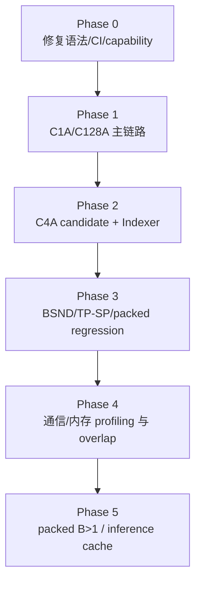

#### 10.2.1 演进路线图说明

| 阶段 | 目标 | 进入下一阶段条件 |
|---|---|---|
| Phase 0 | Core 在声明 Python 版本可导入，官方 op capability 可探测 | compile/import/环境检查通过 |
| Phase 1 | C1A/C128A forward/backward 与 window/global cu 正确 | NPU golden 和 CP=1 reference 一致 |
| Phase 2 | C4A default/fused/dense Indexer compact order 正确 | sparse indices、residual、梯度 shape 一致 |
| Phase 3 | BSND B>1、TND packed、TP/SP/MTP 回归 | 全组合 validator 与 NPU smoke 通过 |
| Phase 4 | 降低 P2P/all-gather wait 与 dense score 内存 | profiling 证明收益且不改数值 |
| Phase 5 | 扩展 ragged BSND、packed B>1 或 inference cache | CANN/kernel contract 明确支持 |

优先级原则：**先正确性，再 Indexer-loss，再性能重叠，最后扩展尚未支持的输入语义。**

### 10.3 估算假设与风险

| 假设 | 对估算的影响 | 若不满足 |
|---|---|---|
| 已有可用 NPU、TorchNPU 和 CANN extension | 阶段 1–3 只需做适配与回归 | 需增加环境搭建和算子联调，周期至少增加 3–5 日 |
| 模型权重、Indexer 和 baseline 已可运行 | 可直接做数值/梯度对比 | 需先补模型基线，C4A 阶段无法独立验收 |
| CP shard 保持等长连续 | 可复用当前 deterministic selection | ragged/不均匀 shard 需改 metadata 与选块算法 |
| 只统计工程人力，不含硬件折旧和线上运维 | 表中人日可横向比较 | 生产成本需另行按 NPU 规模、序列长度和吞吐测算 |

这些数字是基于当前代码边界的工程量级估算，不是性能承诺；尤其 CANN 版本差异和长序列 HBM 峰值应以目标硬件实测为准。

## 11. 当前测试覆盖

### 11.1 CP adapter CPU 测试

MindSpeed core 的 `test_deepseek_v4_cp_adapter_cpu.py`（1,591 行）当前覆盖：

| 覆盖组 | 代表测试/文件范围 | 重点 |
|---|---|---|
| packed cu/residual | `test_deepseek_v4_cp_adapter_cpu.py:1-130` | sample boundary、residual、packed metadata |
| tail P2P mock | 同文件约 `:90-180` | multi-tail flatten、backward gradient |
| candidate/selection | `test_candidate_plan_vectorization.py:1-325`、`test_deterministic_compression_metadata.py:1-244` | vectorized plan、rank-order、cache |
| compact view | `test_compact_candidate_view.py:1-194` | alias source、left boundary view |
| shared candidate | `test_shared_compression_candidates.py:1-278` | main/Indexer candidate 复用 |
| SMLA input/alignment | adapter CPU 文件后半段 | TND/BSND、prefix、sparse remap/fallback |

静态统计共有 112 个 `test_*` 函数；NPU 测试类不计入该函数数。

### 11.2 attention bridge CPU/mock 测试

`test_deepseek_v4_attention_bridge_cpu.py`（882 行）覆盖 C1A/C4A/C128A dispatch、prepared KV、runtime metadata、BSND batch、Indexer-loss bridge mock，以及错误输入拒绝。重点应对应：

```text
q/ori shape -> runtime metadata
prepared/source contract -> compressed prepare
SMLA inputs -> fake npu_sparse_flash_mla_from_smla_inputs
indexer query/key/weights -> fake indexer-loss wrapper
```

### 11.3 SMLA wrapper 测试

`tests_extend/unit_tests/mindspeed/ops/test_npu_sparse_flash_mla.py`（15 个测试函数）覆盖官方 op lazy-load mock、metadata inference、TND/BSND normalize、C1A/C4A/C128A 参数拒绝、standard grad 和 Indexer-loss grad mock。`test_npu_sparse_flash_mla_npu.py` 与 `test_npu_sparse_flash_mla_real_npu.py` 提供 NPU smoke/golden，但本机未执行。

### 11.4 Lightning Indexer 与 LLM 集成测试

MindSpeed-LLM `tests/ut/context_parallel/test_deepseek_v4_cp_integration.py`（4,607 行）覆盖：

| 主题 | 代表范围 |
|---|---|
| args/feature/patch | `:464-575`、`:4454-4583` |
| batch slicing/MTP metadata | `:641-1102` |
| shared FP32/detached candidate | `:1294-1750` |
| adapter TND/BSND/TP-SP | `:1753-1988` |
| callback/overlap/position | `:1999-2231` |
| fused/dense right-aligned Indexer | `:2870-3455` |
| packed/BSND Indexer-loss | `:3622-4453` |

静态统计 85 个集成测试函数；连同 `test_deepseek_utils.py`、MTP metadata contract 和 residual 测试，共 96 个 `test_*` 函数。

### 11.5 尚未覆盖与本机验证结果

```text
1. 当前 Python 3.7.4 无法编译 _distributed.py:121 的 starred return。
2. 本机缺少 megatron，MindSpeed CP pytest 在 collection 阶段停止。
3. 本机缺少 xxhash，MindSpeed-LLM conftest 无法加载。
4. 本机缺少 torch_npu/cann_ops_transformer，真实 SMLA forward/backward 未执行。
5. 尚无长序列 HBM、all-gather wait、P2P overlap 的实测表。
6. 尚无 inference KV-cache、packed physical batch>1 的实现/测试。
```

### 11.6 测试分层与建议执行顺序

| 层级 | 先执行的测试 | 证明什么 | 不能证明什么 |
|---|---|---|---|
| 静态/语法 | 对 Core 与 LLM 声明版本运行 `py_compile`/`compileall` | import、语法和版本门槛 | 分布式通信或 CANN 数值 |
| CPU/mock | `deepseek_v4_cp_adapter`、candidate、bridge、wrapper mock | layout、metadata、selection、错误输入和 autograd 形状 | 官方 kernel 性能/精度 |
| 单卡 NPU | SMLA NPU smoke、C1A/C4A/C128A | CANN 参数组合和 metadata 可执行 | 多 rank P2P 梯度 |
| 多卡 NPU | CP=2/4、TP×CP、packed/BSND | tail、all-gather、prefix/index 对齐和反向 | 未实现的 inference cache/ragged batch |
| 长序列 profiling | HBM、通信 wait、dense top-k | 是否获得实际吞吐/显存收益 | 功能正确性（需与 golden 分开） |

推荐顺序是“语法 → CPU/mock → 单卡 NPU → 多卡 NPU → profiling”。当前工作区已完成静态阅读和文件级引用核对，但由于缺少 `megatron`、`xxhash`、`torch_npu` 与 `cann_ops_transformer`，本机不能把后四层结果误报为通过。

## 12. 总结与下一步

### 12.1 整体评价

新实现已经把 DS V4 CP 从早期的单一 bridge 设计推进为可复用的分层 runtime：G2 模型层负责 q/ori_kv/hidden 与模型数学；LLM adapter 负责 `[S,B]` 到 TND/BSND、TP/SP offset、C4A Indexer 和输出恢复；MindSpeed core 负责 candidate ownership、P2P/all-gather、确定性 block order、prefix alignment；CANN wrapper 负责融合 attention 和反向。旧版“BSND 压缩只能 B=1”“只能 kvallgather”“需要 runtime dataclass/config 入口”等结论已经被当前代码替代。

### 12.2 最优先解决的 3 个问题

1. **修复 `_distributed.py:121` 并建立声明 Python 版本的 compile/import CI。** 当前环境可直接复现语法错误，属于可用性阻断。
2. **完成目标 CANN 上 C4A（含 Indexer-loss）和 BSND/TND 的 forward/backward golden。** 重点验证 residual、prefix alignment、shared batch 和通信梯度。
3. **恢复低层入口与 prepared/callback state 的一致性校验。** 防止外部错误输入以 opaque kernel error 或静默 block-order 偏差出现。

### 12.3 后续分析方向

```text
1. 用 CP=1 reference 与 CP=2/4 NPU 输出逐层对齐 q/ori/cmp/index。
2. 建立 ratio × layout × batch × TP/SP × packed 的自动化矩阵。
3. 统计 candidate capacity、valid_count、compact view 命中率和通信 wait。
4. 评估 CANN 9.0/9.1 对 cmp_mask_mode、empty TND batch、Grad 输出的差异。
5. 在 kernel 支持明确后设计 packed B>1/ragged BSND 与 inference cache 的 metadata 生命周期。
```

<!-- archive-notes-summary-visual:start -->
## 总结图

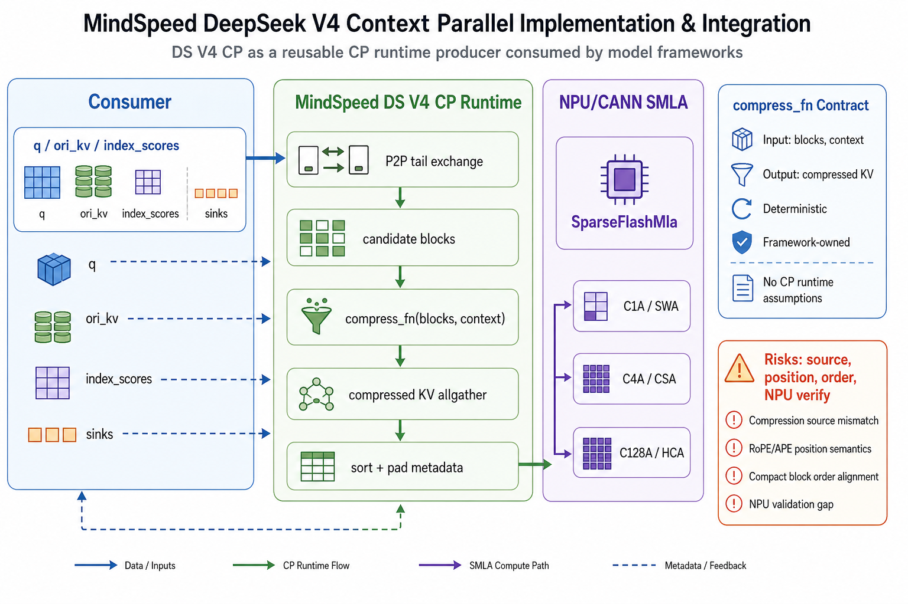
<!-- archive-notes-summary-visual:end -->

✅ 已完成 5 轮自审修正
