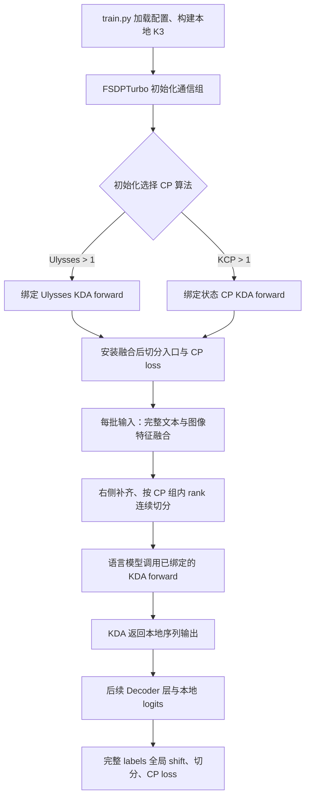
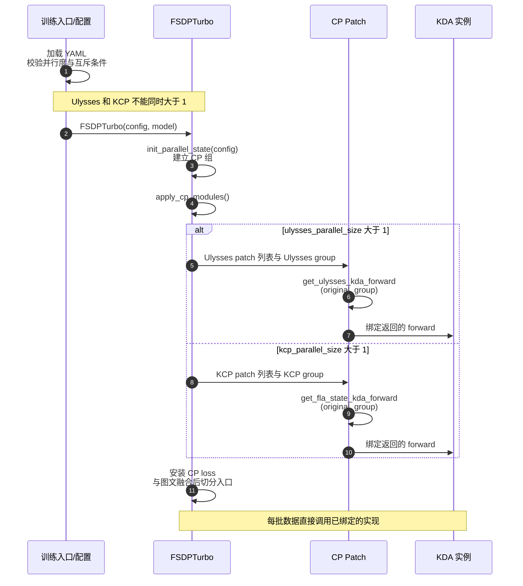
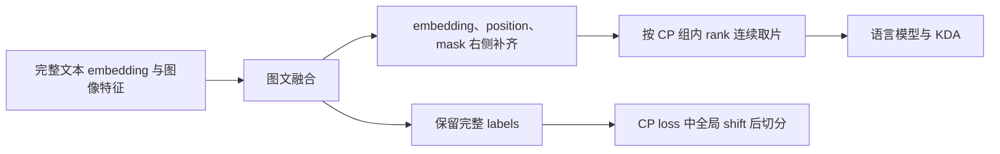
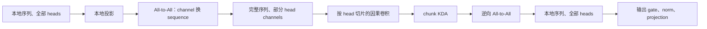
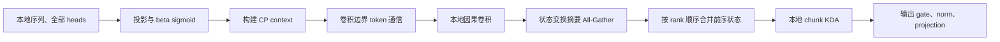
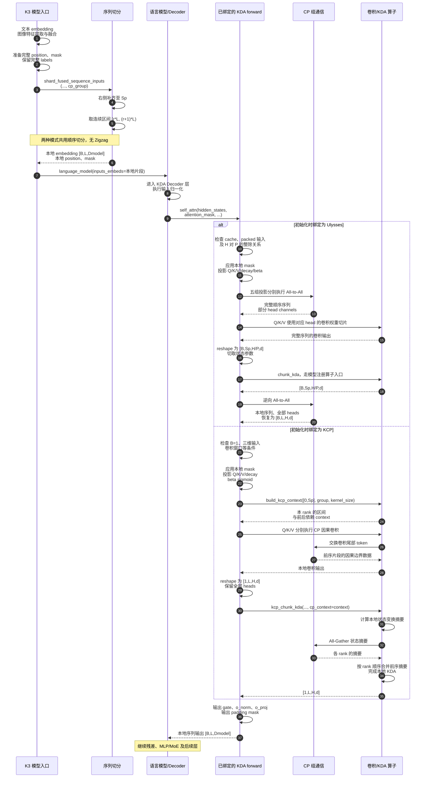
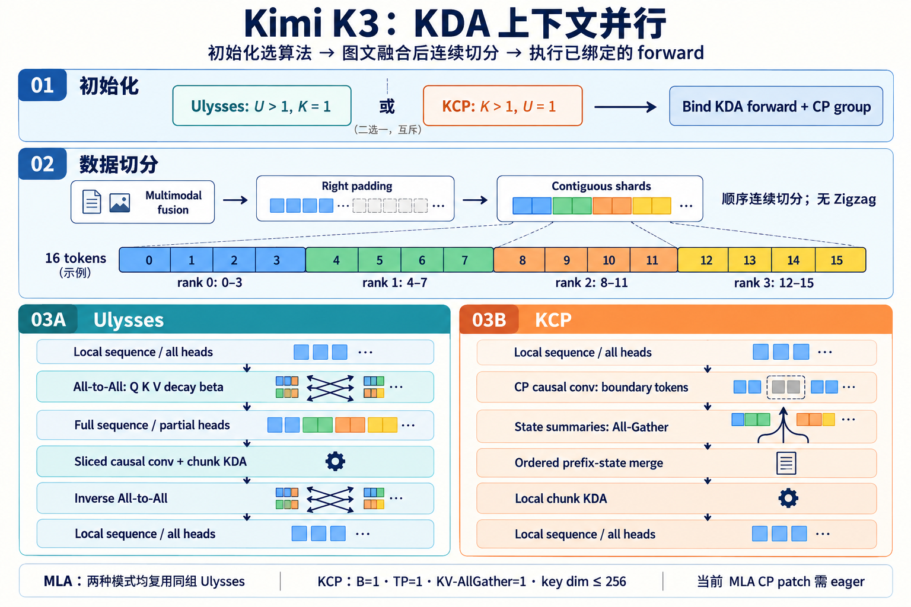

# Kimi K3：KDA 与 MLA 上下文并行配置及实现顺序图

## 1. 文档摘要

本文分析 FSDPTurbo 的 Kimi K3 CP 实现，覆盖 KDA/MLA 算法组合、使能条件、融合后连续切分及执行顺序图。核心结论：完整模型接入 Ulysses 与 KCP 两套路径；KCP 保留 KDA 全部 heads，MLA 仍使用同组 Ulysses；当前无 Zigzag 切分。默认 attention 后端、padding mask 和长序列显存是需要重点关注的风险。

## 2. 整体概述

### 2.1 KDA、MLA 与 CP 的职责

K3 的语言模型按模型配置装配 KDA 或 MLA 层：`KimiDecoderLayer.__init__` 根据 `config.is_kda_layer(layer_idx)` 选择 `KimiDeltaAttention`，否则在 MLA 配置下选择 `KimiMLAAttention`。本文分析的对象是两类层共存时的完整 K3 CP 路径。

| 对象 | 核心职责 | CP 中的关键区别 |
|---|---|---|
| KDA | 含因果短卷积和递推状态的线性注意力 | 可使用 Ulysses 的序列/head 交换，或 KCP 的状态并行 |
| MLA | 多潜变量全注意力 | 当前两种完整 K3 CP 模式均复用 Ulysses 包装 |
| K3 模型入口 | 图像特征提取、图文融合和语言模型调用 | 必须先融合完整样本，再切分语言序列 |
| CP loss | 完整标签移位、切分与全局归一化 | labels 在进入 loss 前保留完整且未 shift 的形式 |

### 2.2 当前算法组合支持矩阵

| 模式 | KDA 算法 | MLA 算法 | 并行度设置 | 结论 |
|---|---|---|---|---|
| **Ulysses CP** | 序列/head-channel All-to-All | Ulysses All-to-All | `ulysses_parallel_size=P>1`、`kcp_parallel_size=1`、KV-AllGather=1 | 完整 K3 已接入；示例默认选择此模式 |
| **KCP** | 保留全部 heads，通过状态摘要恢复跨分片依赖 | 在 **KCP 通信组**上执行 Ulysses | `kcp_parallel_size=P>1`、`ulysses_parallel_size=1`、KV-AllGather=1 | 完整 K3 已接入；额外限制见第 4 节 |
| 无 CP | 原始 KDA | 原始 MLA | 三种 CP 并行度均为 1 | 基线模式 |
| Ulysses × KCP | — | — | 两者同时大于 1 | 配置校验拒绝 |
| KCP × KV-AllGather | — | — | 两者同时大于 1 | 配置校验拒绝 |
| KV-AllGather 或 Ulysses × KV-AllGather | KDA 未覆盖 KV-AllGather 轴 | 框架存在通用 Full Attention 包装 | 不能据此得到完整 K3 CP 路径 | 当前 K3 未完整接入 |
| Ring / Zigzag | 当前 KDA 路径未接入 | 当前 K3 路径未提供相应配置 | 无对应使能开关 | 不属于当前可用 K3 配置 |

**框架存在通用 KV-AllGather，不代表 KDA+MLA 的完整 K3 已支持该轴。**K3 融合后切分只选择 KCP 或 Ulysses 组；KDA 的 patch 类型也只允许放在这两类字段中。不能将通用包装器的能力直接外推为模型支持范围。

### 2.3 整体架构图



**算法在初始化时绑定，数据在每批前向中切分。**图中两者不能倒置为“切分之后再根据内容动态选择算法”。

### 2.4 技术栈与代码规模

- 核心技术栈：PyTorch Distributed、Transformers、Triton/Ascend Triton、FLA，以及普通 KDA 路径可选的 AscendC 实现。
- 示例目录包含 4 个文件，共 599 行：README 252 行、YAML 171 行、启动脚本 50 行、训练入口 126 行。

## 3. 核心模块分析

### 3.1 初始化、配置分发与 forward 绑定

**职责与边界：**`FSDPTurbo.apply_cp_modules`按当前并行度应用对应 patch 列表；`apply_kda_patches`选择 forward 工厂，将通信组捕获在返回的闭包中，并绑定到模型中匹配的 KDA 实例。



核心代码：

```python
if label == "Ulysses":
    from fsdp_turbo.modules.kda import get_ulysses_kda_forward

    forward_factory = get_ulysses_kda_forward
elif label == "KCP":
    from fsdp_turbo.distributed.context_parallel.kcp.kda_state import get_fla_state_kda_forward

    forward_factory = get_fla_state_kda_forward
else:
    raise ValueError(f"KDA patches are not supported in the {label!r} patch field.")

for target in spec["target_functions"]:
    target_class, member_name = resolve_class_member(target)
    original = getattr(target_class, member_name)
    replacement = forward_factory(original, group)
    matched = patch_model_members(model, target, replacement)
```

**关键数据流：**YAML 并行度与 patch 列表 → 当前 CP 通信组 → 工厂生成的 forward → KDA 模型实例。该阶段依赖配置、通信组和框架级 patch 工具，不根据 batch 内容做自适应算法选择。

### 3.2 融合后连续切分：两种算法共用

**职责与边界：**`kimi_k3_model_forward`先处理完整图文输入，再调用 `shard_fused_sequence_inputs`。切分发生在语言模型入口之前，不是在 dataloader 中提前切图文 token。



关键代码：

```python
complete_attention_mask = attention_mask
complete_labels = _mask_labels(labels, complete_attention_mask, self.config.ignore_index)
num_items_in_batch = kwargs.pop("num_items_in_batch", None)
if cp_size > 1:
    inputs_embeds, position_ids, attention_mask = shard_fused_sequence_inputs(
        inputs_embeds=inputs_embeds,
        position_ids=position_ids,
        attention_mask=attention_mask,
        group=cp_group,
    )
```

设融合长度为 \(S\)、CP 并行度为 \(P\)、组内 rank 为 \(r\)：

\[
S_p=\lceil S/P\rceil P,\quad L=S_p/P,\quad I_r=[rL,(r+1)L)
\]

**两种模式均按连续区间切分，没有 Zigzag 首尾配对重排。**`sequence_parallel_range` 与 `split_tensor_to_group` 先计算 `start = rank * chunk`，再通过 `narrow` 取片。

| CP 组内 rank | 当前实现，补齐后 16 token、CP=4 | 典型 Zigzag 配对示例，仅作对比 |
|---|---|---|
| 0 | `0–3` | `0–1`、`14–15` |
| 1 | `4–7` | `2–3`、`12–13` |
| 2 | `8–11` | `4–5`、`10–11` |
| 3 | `12–15` | `6–7`、`8–9` |

KCP 配套 context 同样以 `rank_start = part_len * rank` 解析序列区间；因此不能仅将输入换成首尾拼接后沿用现有状态上下文。

### 3.3 Ulysses KDA：完整序列、部分 heads

**职责与边界：**`get_ulysses_kda_forward`包装 KDA。投影在本地序列上执行，随后对 Q/K/V/decay/beta 分别进行 All-to-All，以 head/channel 分片换取完整顺序序列；卷积和 KDA 后再恢复本地序列布局。



核心代码：

```python
query = _sequence_to_local_channels(module.q_proj(hidden_states), group)
key = _sequence_to_local_channels(module.k_proj(hidden_states), group)
value = _sequence_to_local_channels(module.v_proj(hidden_states), group)
decay = _sequence_to_local_channels(module.f_b_proj(module.f_a_proj(hidden_states)), group)
beta = _sequence_to_local_channels(module.b_proj(hidden_states), group)

query = _sliced_short_convolution(module.q_conv1d, query, rank)
key = _sliced_short_convolution(module.k_conv1d, key, rank)
value = _sliced_short_convolution(module.v_conv1d, value, rank)

full_seq_len = query.size(1)
query = query.view(batch_size, full_seq_len, local_num_heads, module.head_k_dim)
key = key.view(batch_size, full_seq_len, local_num_heads, module.head_k_dim)
value = value.view(batch_size, full_seq_len, local_num_heads, module.head_dim)
decay = decay.view(batch_size, full_seq_len, local_num_heads, module.head_dim)
```

**关键结构与依赖：**卷积前为三维 channel 张量；卷积后将 Q/K/V 展开为 `[B,Sp,H/P,d]`。状态参数也按对应 heads 切片。计算依赖模型所暴露的 `chunk_kda` 注册入口，不在该包装中重写算子后端选择。输出在逆向交换后恢复为 `[B,L,H,d]`。

### 3.4 KCP KDA：本地序列、全部 heads

**职责与边界：**`get_fla_state_kda_forward`保留全部 heads，在本地连续序列上投影和计算。跨 rank 的依赖分别由 CP 感知卷积和 KDA 状态摘要处理。



核心代码：

```python
output = kcp_chunk_kda(
    q=query,
    k=key,
    v=value,
    g=decay,
    beta=beta,
    A_log=module.A_log,
    dt_bias=module.dt_bias,
    lower_bound=module.gate_lower_bound,
    disable_recompute=getattr(module.config, "skip_kda_recompute", False),
    context=context,
)
```

**关键结构与依赖：**包装内部用 `[0, local_sequence_length * world_size]` 创建完整序列边界，传入 context 构造器；这不代表支持用户传入多样本 packed `cu_seqlens`。本地 Q/K/V 为 `[1,L,H,d]`，保持全部 heads。

`kcp_causal_conv1d` 调用 FLA 的 CP 卷积，`kcp_chunk_kda` 直接调用支持 `cp_context` 的 Ascend Triton KDA。当前配套 kernel 对状态变换摘要做 All-Gather，再按前序 rank 顺序合并。**它不是完整 Q/K/V 序列 All-Gather，也不能画成已经实现的纯 P2P Ring。**

### 3.5 每批前向的完整顺序图

以下只展开 KDA 自注意力分支。`B` 表示微批次，`Dmodel` 表示隐藏维度；残差、MoE、MLA 及反向未展开，但 KDA 返回后的处理位置明确标出。



### 3.6 MLA 与 CP loss 的配合

**MLA：**KCP 模式的 `full_attention` 类型映射到 `get_ulysses_attention_fn`，因此依然存在 head 切分约束。当前 `KimiMLAAttention.forward` 根据 attention 后端选择本地 eager 函数或 Transformers 注册表。

**CP loss：**`cp_compute_lm_loss` 对完整 labels 先全局 shift，再补齐和切分；`cp_fixed_cross_entropy` 归并 loss 和有效 token 数，分母至少为 1，并为与 FSDP 的梯度平均配合提供补偿。不要在数据加载处提前切 labels 或再次 shift，也不要额外 all-reduce 已同步的 loss。

关键代码：

```python
"""Shift complete labels globally and align them with local CP logits."""
logits = logits.float()

shifted_labels = torch.full_like(labels, ignore_index)
shifted_labels[..., :-1] = labels[..., 1:]
seq_dim = shifted_labels.dim() - 1
shifted_labels = pad_tensor_to_group(shifted_labels, group, dim=seq_dim, pad_value=ignore_index)
labels = split_tensor_to_group(shifted_labels, group, dim=seq_dim)
if labels.shape != logits.shape[:-1]:
    raise ValueError(
        "CP loss label/logit shape mismatch after complete-sequence shift and split: "
        f"local_labels={tuple(labels.shape)}, logits_without_vocab={tuple(logits.shape[:-1])}. "
        "Labels must enter the model complete and unshifted, and model-side CP must produce local logits."
    )
```

## 4. 关键技术点与使能配置

### 4.1 在现有 YAML 上使能两种模式

下面是**修改现有同名字段的片段，不是完整训练配置文件**。保留原 FSDP、EP 及其他配置，不要在同一个 YAML 中追加重复的顶层键。

#### Ulysses CP

```yaml
model:
  attn_implementation: eager
distributed:
  tensor_parallel_size: 1
  ulysses_parallel_size: 2
  kcp_parallel_size: 1
  kv_allgather_parallel_size: 1
```

#### KCP

```yaml
model:
  attn_implementation: eager
data:
  batch_size: 1
distributed:
  tensor_parallel_size: 1
  ulysses_parallel_size: 1
  kcp_parallel_size: 2
  kv_allgather_parallel_size: 1
```

`2` 仅是示例并行度，仍需符合第 4.3–4.4 节条件。**KCP 模式不需要同时增大 Ulysses 并行度**：MLA 的 Ulysses 包装由 KCP patch 自动绑定到 KCP 组。

### 4.2 保留完整 patch 计划

当前示例同时含两套计划，可保留以下结构：

```yaml
distributed:
  cp_plan:
    ulysses_function_patches:
      - target_functions:
          - modeling_kimi_linear.eager_attention_forward
        type: full_attention
      - target_functions:
          - modeling_kimi_linear.KimiDeltaAttention.forward
        type: kda
    kcp_function_patches:
      - target_functions:
          - modeling_kimi_linear.eager_attention_forward
        type: full_attention
      - target_functions:
          - modeling_kimi_linear.KimiDeltaAttention.forward
        type: kda
    loss_function_patches:
      - target_functions:
          - transformers.loss.loss_utils.ForCausalLMLoss
        type: causal_lm_loss

module_patches:
  - target: modeling_kimi_k3.KimiK3ForConditionalGeneration.forward
    replacement: fsdp_turbo.models.kimi.kimi_k3_cp.kimi_k3_model_forward
```

**当前必须将 `model.attn_implementation` 改为 `eager`。**YAML 原值是 `flash_attention_2`，训练入口读取该字段，并未像 README 所述强制改为 eager。非 eager MLA 转到另一个函数注册入口，不会因为本地 eager 函数被包装就自动获得相同 CP 逻辑。

### 4.3 硬条件、边界与异常处理

| 条件 | Ulysses KDA / 完整 K3 | KCP KDA / 完整 K3  |
|---|---|--- |
| KDA head 数 | 必须被 CP 并行度整除 | 无 head 切分产生的整除要求  |
| MLA query head 数 | 必须被 CP 并行度整除 | **同样必须被 CP 并行度整除**  |
| TP | 示例使用 TP=1；TP>1 需额外确认 K3 的张量切分适配 | **必须为 1**  |
| KV-AllGather | 当前完整 K3 路径保持为 1 | **必须为 1**  |
| 微批次 | 无 KCP 特有的 batch=1 校验；padding 正确性另见风险 | **配置及实际 forward batch 都必须为 1**  |
| 输入布局 | 融合后 BSH、二维序列 mask | **BSH，batch=1**  |
| 外部 packed/cu_seqlens | KDA CP 明确拒绝 | 明确拒绝  |
| cache / generation | 不支持 | 不支持  |
| chunk loss | 与 CP 互斥 | 与 CP 互斥  |
| 融合序列长度 | 自动右侧补齐，不必手工整除 | 同左  |
| KDA 卷积 | 切片卷积要求 bias=False | 窗口必须大于 1  |
| KDA key head dimension | 受实际后端约束；当前配套 Triton 不超过 256 | **不超过 256**  |
| safe gate 下界 | 受实际后端约束；当前配套 Triton 要求 [-5,0) | 非空时 **必须位于 [-5,0)**  |

FLA CP 卷积实现还有一个隐含短序列要求：每 rank 序列长度应至少覆盖“卷积窗口−1”个 token。其反向固定向末尾对应长度的区间回写梯度，FSDPTurbo 未提前检查该边界。这是对该依赖实现的边界分析，不是 YAML 已有的显式校验。

输入还应保持：完整且未 shift 的 labels、`use_cache=False`。示例训练步骤已设置 `use_cache=False`。自动补齐长度不能替代 padding mask 语义的处理，参见 R2。

### 4.4 head 数、world size 与独立 mesh

令 \(W\) 为总进程数、\(H_K\) 为 KDA head 数、\(H_M\) 为 MLA query head 数。

在本文推荐的 TP=1、KV-AllGather=1 条件下：

- Ulysses 的必要条件：\(P>1\)，同时整除 \(W,H_K,H_M\)。
- KCP 的必要条件：\(P>1\)，同时整除 \(W,H_M\)，并满足其他 batch/算子条件。

三组 mesh 还分别要求：

```text
W % (fully_shard_parallel_size * tensor_parallel_size) == 0
W % (expert_fully_shard_parallel_size * expert_parallel_size) == 0
W % (当前启用的CP并行度 * tensor_parallel_size) == 0
```

这些 mesh 独立构建，不能将 FSDP×EP×CP 全部相乘作为所需进程数。例如示例 FSDP=16、EP=16、CP=2，在 mesh 整除关系上可使用 W=16；仍需满足模型 head 等约束。可用并行度应按实际模型的 head 数确定，不能只根据 world size 选取。

### 4.5 算子依赖、启动入口与性能特征

| 项目 | Ulysses KDA | KCP KDA |
|---|---|---|
| 算子路由 | 模型的注册算子入口；NPU 后端按依赖选择 AscendC、Triton 或 eager | 直接调用支持 CP context 的 Ascend Triton KDA 与 FLA CP 卷积 |
| 普通 eager 回退能否替代状态 CP | 普通 KDA 注册层有 eager 回退 | **不能替代 KCP 状态通信路径** |
| 核心布局 | `[B,L,H,d]` → `[B,Sp,H/P,d]` → `[B,L,H,d]`，中间投影/卷积为 channel 布局 | 保持 `[1,L,H,d]`，通过卷积边界和状态摘要关联前序片段 |
| 性能结论 | 全序列上的部分 heads；有投影 All-to-All 和逆向交换 | 避免 KDA 的完整序列/head 交换，但有状态摘要通信与合并开销 |

不能由布局差异推导 KCP 一定更快，需按目标序列长度、head 维度、通信规模实测。

**示例入口仍需要可用的 Triton driver**：`build_model` 无条件调用 driver 初始化，因此普通 KDA 算子层有 eager 回退，并不代表完整示例可以不具备该入口依赖。

在 FSDPTurbo 仓库根目录运行：

```bash
torchrun --nproc_per_node=16 examples/kimi_k3/train.py --config config.yaml
```

当前只有 `--ulysses-size`，没有 `--kcp-size`；切换两种模式优先直接修改 YAML。CP 与 `memory.chunk_batch` 的组合不能仅根据通用配置字段推定可用。

## 5. 问题与风险评估

| 编号 | 严重程度 | 问题/触发条件 | 影响 |
|---|---|---|---|
| R1 | **高** | 默认 `flash_attention_2` 与 MLA eager CP patch 不匹配 | MLA 实际执行路径未被当前 eager patch 覆盖，属于注意力依赖正确性风险 |
| R2 | **高，针对相应输入** | CP 重建 MLA 全局因果 mask 时未保留原 padding 屏蔽信息 | 左 padding/内部 masked token 的语义不能保证，被屏蔽 key 在重建后的因果三角内重新可见 |
| R3 | **中，性能/显存** | 当前 MLA eager 显式生成分数矩阵，CP 包装生成完整 Sp×Sp mask | 长序列仍有二次方显存项，KCP 不能消除 MLA 这一开销 |
| R4 | **低，配置可维护性** | CLI 在配置对象校验后覆盖 Ulysses 并行度 | 覆盖后的值未重新执行配置对象校验，部分错误延迟至 mesh 初始化才暴露 |

### 5.1 padding 风险的适用范围

R2 的重建函数只生成因果三角，输入 mask 仅用于取得 batch 大小，没有合并原 padding 屏蔽。因此，原本被 padding mask 屏蔽的 key，只要位于重建后的因果三角内，仍会变为可见。

**自动追加到完整序列末尾的对齐 padding，不能与左侧或内部 padding 混为一谈。**自动补齐长度不能替代对 padding mask 语义的处理。

### 5.2 其他边界

packed/cache/chunk loss 等限制已在第 4.3 节列出。短分片卷积边界见第 4.3 节。

## 6. 优化建议

以下建议与第 5 节的问题一一对应。

| 对应问题 | 具体措施 | 预期收益 | 难度 | 优先级 |
|---|---|---|---|---|
| R1 | 现阶段显式设置 eager；补充后端与 CP patch 匹配检查，并同步修正 README | 确保 MLA 进入已接入的 CP 路径，提前识别错误配置 | 低 | P0 |
| R2 | 重建全局因果 mask 时保留全局 padding 信息；对左/右/内部 padding 比较 CP 与非 CP 的输出、loss 和梯度 | 消除特定输入下的注意力语义偏差 | 中 | P0 |
| R3 | 在目标长度先记录 MLA 峰值显存，再适配融合注意力 CP 路径并验证 mask/梯度 | 降低长序列显存压力；收益必须实测 | 高 | P1 |
| R4 | 在构建配置对象前合并 CLI 覆盖值，统一执行最终配置校验 | 避免校验前后配置不一致，改善可维护性 | 低 | P2 |

对“改成 Zigzag”的扩展需求，应单独评估全局 token 映射、KDA 卷积边界、状态上下文、MLA mask 与 loss 对齐，不能作为当前配置开关使用。本文不将其列为已支持方案，也不估算未经分析的实施周期。

## 7. 总结与下一步

### 7.1 整体评价与优先事项

当前实现复用了统一的配置/patch 框架、融合后切分和 CP loss；Ulysses 的完整序列/部分 heads 与 KCP 的本地序列/全部 heads 职责清楚。KCP 解除的是 **KDA 自身的 head 切分约束**，整个 K3 仍受到 MLA Ulysses 的 head 数整除限制。

最优先的三项工作：

1. 修正 attention 后端与实际 patch 路径不一致的问题。
2. 修复 padding mask 语义，并补充两种 CP 与非 CP 的输出/loss/梯度对照。
3. 测量长序列下 MLA 的峰值显存，评估融合注意力 CP 适配。

之后对目标序列长度的显存、通信和耗时进行对照测试，确定两种模式的实际性能差异。

### 7.2 独立设计图

正文保留可编辑 Mermaid，并提供独立 SVG，便于缩放和导出。

| 设计图 | 可编辑源文件 | 独立矢量图 |
|---|---|---|
| 总体架构 | [Mermaid](chapter-04-kimi-k3-cp-diagrams/architecture.mmd) | [SVG](chapter-04-kimi-k3-cp-diagrams/architecture.svg) |
| 初始化算法选择顺序图 | [Mermaid](chapter-04-kimi-k3-cp-diagrams/initialization-sequence.mmd) | [SVG](chapter-04-kimi-k3-cp-diagrams/initialization-sequence.svg) |
| 图文融合后切分 | [Mermaid](chapter-04-kimi-k3-cp-diagrams/post-fusion-sharding.mmd) | [SVG](chapter-04-kimi-k3-cp-diagrams/post-fusion-sharding.svg) |
| Ulysses KDA 执行流程 | [Mermaid](chapter-04-kimi-k3-cp-diagrams/ulysses-kda.mmd) | [SVG](chapter-04-kimi-k3-cp-diagrams/ulysses-kda.svg) |
| KCP KDA 执行流程 | [Mermaid](chapter-04-kimi-k3-cp-diagrams/kcp-kda.mmd) | [SVG](chapter-04-kimi-k3-cp-diagrams/kcp-kda.svg) |
| 每批 KDA 前向顺序图 | [Mermaid](chapter-04-kimi-k3-cp-diagrams/forward-sequence.mmd) | [SVG](chapter-04-kimi-k3-cp-diagrams/forward-sequence.svg) |

<!-- archive-notes-summary-visual -->

## 总结图



✅ 已完成 5 轮自审修正
